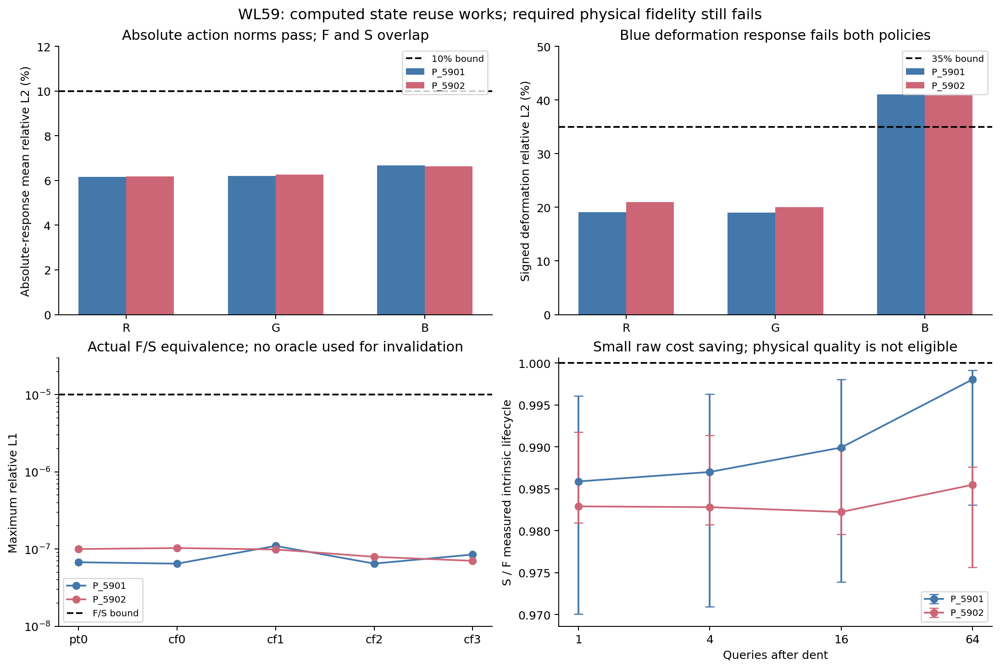
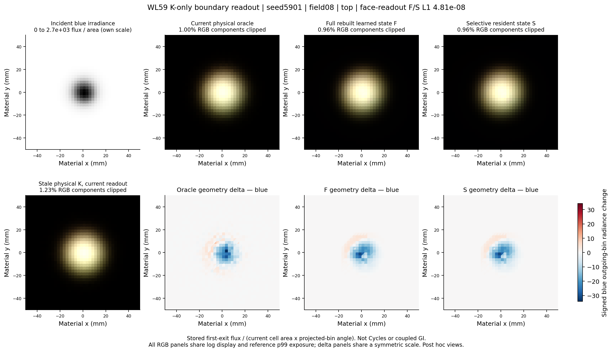

# WL57–59 시각화 산출물

이 문서는 그림을 찾기 위한 색인입니다. 측정·판정의 원본은 각 Worklog와 JSON에 있습니다. WL58·59의 누락된 그림을 완료된 데이터에서 사후 보완했으며, 기존 실험·판정은 변경하지 않았습니다.

| Worklog | 산출물 | 렌더링 범위 |
|---|---|---|
| [WL57](../worklogs/57_WORKLOG_LEARNED_INTRINSIC_K_RULE_STATE.md) | [기존 요약 PNG](../../results/fnto_rule57/recovery_a2/final/out/review/summary.png), [PDF](../../results/fnto_rule57/recovery_a2/final/out/review/summary.pdf) | learned operator 기준 미달로 coupled GI 미실행 |
| [WL58](../worklogs/58_WORKLOG_PERSISTENT_INTRINSIC_STATE_REUSE.md) | 아래 GGX gate/lobe 그림 | analytic angular probe만 실행; F/S나 GI 장면 렌더가 아님 |
| [WL59](../worklogs/59_WORKLOG_PERSISTENT_INTRINSIC_FS.md) | 아래 그래프·기하·K-only 비교 이미지 | 저장된 first-exit flux의 face-on boundary-bin readout; Cycles나 coupled GI 렌더가 아님 |

## WL58

- [전체 angular gate PNG](../../results/evaluation/58/angular_gate.png) / [PDF](../../results/evaluation/58/angular_gate.pdf): 선언된 모든 case와 source-alias 하한.
- [GGX lobe 비교 PNG](../../results/evaluation/58/angular_lobes.png) / [PDF](../../results/evaluation/58/angular_lobes.pdf): 동일하게 인코딩되는 X/Y 입력의 analytic 응답과 최적 histogram projection. 고정 evaluator를 이용한 사후 설명 그림이며 새로운 gate 결과가 아닙니다.

## WL59 그래프

- [요약 PNG](../../results/evaluation/59/summary.png) / [PDF](../../results/evaluation/59/summary.pdf)
- [모든 primary 방향 pair/channel PNG](../../results/evaluation/59/directional_all.png) / [PDF](../../results/evaluation/59/directional_all.pdf)
- [학습 곡선 PNG](../../results/evaluation/59/training.png) / [PDF](../../results/evaluation/59/training.pdf)
- [비용·메모리·재구축 범위 PNG](../../results/evaluation/59/cost_and_state.png) / [PDF](../../results/evaluation/59/cost_and_state.pdf)
- [실제 rest/dent 기하 PNG](../../results/evaluation/59/geometry.png) / [PDF](../../results/evaluation/59/geometry.pdf): 변위 색상이며 조명 영상이 아닙니다.



## WL59 K-only 비교 이미지

입사 field를 고정한 상태에서 현재 physical oracle, full rebuild F, selective S, stale physical K 및 blue geometry delta를 비교합니다. 이미 저장된 응답에 `flux / (current port area × projected-bin angle)`을 적용했습니다. 삼각형의 현재 normal/tangent를 사용한 ±z 방향 readout을 material x/y 위에 표시했습니다. 새로운 neural inference, 학습 또는 coupled solve는 실행하지 않았습니다.

입력 패널은 화면에 표시한 면의 입사량만 보여줍니다. 다른 면으로 들어온 빛도 K를 통해 이 면에서 나올 수 있습니다. RGB 비교 패널은 reference p99에서 정한 공통 log exposure를 사용하고 clipping 비율을 표시했습니다. 입력 irradiance는 별도 척도이며, blue delta 세 패널은 같은 대칭 척도입니다. 이는 independent continuous-camera reference가 아니며 원래 물리 정확도 판정을 대체하지 않습니다.

Field0은 고정된 첫 focused field, field8은 첫16개 중 reference의 blue integrated-flux 변화가 가장 큰 field를 **reference만으로 사후 선택**한 진단 예시입니다. Field62/63은 primary 방향 pair7의 두 입력을 모두 보여줍니다. 이러한 표시 선택은 평가 population이나 기준을 바꾸지 않습니다.

| Seed | Field | Top (+z) | Bottom (-z) |
|---:|---:|---|---|
| 5901 | 0 | [PNG](../../results/evaluation/59/K_only_seed5901_field00_top.png) / [PDF](../../results/evaluation/59/K_only_seed5901_field00_top.pdf) | [PNG](../../results/evaluation/59/K_only_seed5901_field00_bottom.png) / [PDF](../../results/evaluation/59/K_only_seed5901_field00_bottom.pdf) |
| 5901 | 8 | [PNG](../../results/evaluation/59/K_only_seed5901_field08_top.png) / [PDF](../../results/evaluation/59/K_only_seed5901_field08_top.pdf) | [PNG](../../results/evaluation/59/K_only_seed5901_field08_bottom.png) / [PDF](../../results/evaluation/59/K_only_seed5901_field08_bottom.pdf) |
| 5901 | 62 | [PNG](../../results/evaluation/59/K_only_seed5901_field62_top.png) / [PDF](../../results/evaluation/59/K_only_seed5901_field62_top.pdf) | [PNG](../../results/evaluation/59/K_only_seed5901_field62_bottom.png) / [PDF](../../results/evaluation/59/K_only_seed5901_field62_bottom.pdf) |
| 5901 | 63 | [PNG](../../results/evaluation/59/K_only_seed5901_field63_top.png) / [PDF](../../results/evaluation/59/K_only_seed5901_field63_top.pdf) | [PNG](../../results/evaluation/59/K_only_seed5901_field63_bottom.png) / [PDF](../../results/evaluation/59/K_only_seed5901_field63_bottom.pdf) |
| 5902 | 8 | [PNG](../../results/evaluation/59/K_only_seed5902_field08_top.png) / [PDF](../../results/evaluation/59/K_only_seed5902_field08_top.pdf) | [PNG](../../results/evaluation/59/K_only_seed5902_field08_bottom.png) / [PDF](../../results/evaluation/59/K_only_seed5902_field08_bottom.pdf) |



## 재현과 출처

코드: `experiments/fnto_visual_review/figures.py`, `export_readouts.py`. `results/evaluation/58/visual_manifest.json`과 `59/visual_manifest.json`에 원본 입력·그림·스크립트 SHA256 및 버전을 기록했습니다. WL59의 축약 readout NPZ와 field-selection manifest도 저장하여, 서버의 큰 actions 파일을 다시 받지 않고 그림을 재현할 수 있습니다.

```sh
XDG_CACHE_HOME=/tmp/rest_visual_cache MPLCONFIGDIR=/tmp/rest_visual_mpl \
python experiments/fnto_visual_review/figures.py --repo . \
  --readouts results/evaluation/59/data/boundary_readouts.npz \
  --readout-manifest results/evaluation/59/data/readout_manifest.json
```

PNG와 PDF를 함께 제공합니다. Coupled GI가 실행되지 않은 이유와 실제 성공/실패 범위는 원본 Worklog의 eligibility 판정에 따릅니다.
