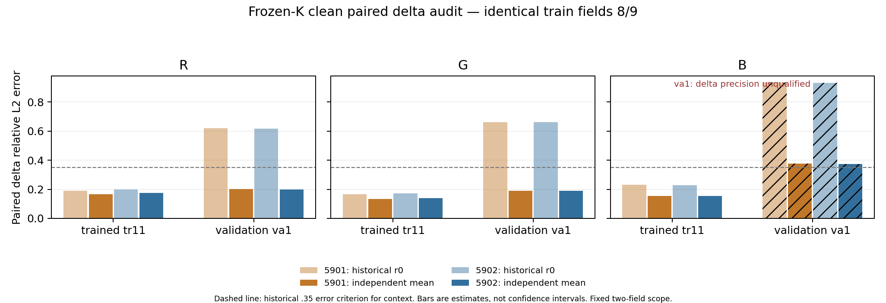

# Worklog61 — Clean paired delta-label audit (2026-10-29)

## Authorisation and fixed scope

The user explicitly authorised one bounded clean-reference follow-up to the completed WL60 attribution. The question is whether the frozen K geometry-associated delta gap persists under independent precise references, rather than being materially explained by historical target error. No architecture, learned parameter, F/S algorithm, loss, training budget, geometry, material or historical verdict changes.

Starting source: `bcf2932`. Branch: `Selective_Recompute`, no new branch/worktree. [Design and interpretation boundary](../plans/CLEAN_PAIRED_DELTA_AUDIT_V1.md); [frozen machine protocol](../../experiments/fnto_delta61/protocol/audit_v1.json). Diagnostic source/protocol committed **before generation** as `edf2da5`.

Exactly **train split fields 8 and 9**, with identical incident arrays at rest, trained dent tr11 and validation dent va1. This is the minimum same-training-light control specified in WL60, not the separately generated validation fields numbered 8/9. Two independent 64M-photon action replicas per geometry/field, each from two 32M halves: **24 halves / 768M photons**. New seeds `610000000 + pose_index*10000 + field_id*100 + replica*10 + half`; no outcome-dependent source selection or photon increase.

Physical entry-to-first-exit reference code, material, 2.5 mm / 16-in / 64-out flux convention and fast execution walker are inherited unchanged from WL59. Independent renderer/analytic validation remains inherited evidence, not a fresh rerun here. All original data, labels and P_5901/P_5902 checkpoints remain read-only. New full half actions/moments live under isolated server root `~/rest_delta61`; small results and reviewer evidence are exported to the new numbered locations only.

## Preresult execution record

LabServer69 was idle before launch (RTX 3090, 1 MiB allocated, no compute peers); `/home` had about 1.3 TB free. A detached server process was started with a new session and audit lock. It runs focused tests, source/input/geometry preflight, exactly the fixed reference generation and CPU-only frozen evaluation; any failed stage stops. No original supervisor or training command is invoked.

All selected geometry/data/checkpoint hashes are pinned to WL59 provenance. Preflight also checks reconstructed material-vertex signatures and parent correspondence, current train fields against their original WL57 train arrays, unchanged reference source hashes, and the exact WL60 replay dependency/baseline hashes.

Uncertainty is recorded separately for single-replica differences and the final four-half mean. First/second moments are aggregated before forming variance. Independent current/rest variance adds for each delta; shared rest cancels in the linear difference of the two geometry deltas and is preserved in coherent replica sensitivity. Two replicas are not a bias proof or independent-pixel confidence interval. Original deformed r0 labels have no compatible independent variance estimate: discrepancy over new-reference SE is not a combined significance test.

Final measurements, eligibility and interpretation are appended after the fixed evidence completes. No inference about a correction or successor follows from launch.

## Pre-reference identity-checker correction (A1)

The initial six tests passed, then preflight stopped **before any reference photon** because it compared current rounded/canonical geometry hashes to legacy saved metadata. Investigation on all three fixed geometries established that the saved signatures exactly equal the reconstructed **raw float64 refined vertex bytes**. Parent maps match exactly, and recomputed xyz/rest_xyz/area/node/pair/prior tensors are bitwise equal to saved tensors for every pose. This is a signature-serialization checker defect, not a geometry or reference mismatch.

A1 checks the exact legacy raw signature, records the current canonical signature separately, and additionally requires bitwise-equal derived geometry features. No threshold, photon count, seed, field, geometry, learned parameter or transport semantics changed. Original source/logs/status and the diagnostic comparison are preserved under `failed_attempts/preflight_edf2da5`; the fixed protocol remains intact with a separate implementation amendment. Final generation remains blocked until corrected preflight passes.

## Fixed-budget completion and post hoc uncertainty review

Exactly 24 halves / 768M photons completed; all passed physical controls. The analysis stopped at `STOP_FIXED_BUDGET_PRECISION`: tr11 RGB and va1 R/G meet the fixed pooled delta SNR rule, while va1 blue does not. No extra photon, changed field, training or successor is launched.

The large historical R/G replay gap shrinks against the new mean actions. A separately versioned, **post hoc read-only** review is declared before computing supplementary outputs: subtract propagated mean-reference variance trace from squared residual/signal norms, and independently cross the two replica residuals. This addresses finite-reference norm inflation in the remaining small gap. Ratios of corrected squared quantities are not unbiased, no confidence interval is claimed, negative squared estimates are retained, and no readiness gate or historical result changes. The reviewer plot explicitly marks unqualified va1 blue.

## Final report — bounded audit closed (client date 2026-10-30)

### Implementation Fact

The fixed population completed: **rest/tr11/va1 × train fields 8/9 × two independent 64M replicas**, with each replica split into two 32M halves. All **24 packets / 768,000,000 photons** passed the unchanged physical checks. There were no generated photons in the failed preflight, no additional population, no packet replacement, no higher-budget retry and no training. Both WL59 checkpoints remain byte-identical and have 157,024 parameters each.

The overall status is **STOP_FIXED_BUDGET_PRECISION**, not a physical-reference implementation failure: absolute-action precision passed everywhere, but **va1 blue delta** failed the frozen SNR>=3 rule. The bounded batch ends here, retaining interpretable qualified-channel findings and explicitly unresolved blue evidence.

Reference construction took **653.764 s**, with individual 32M halves taking **24.418–29.295 s**. Frozen comparison took **11.02 s CPU**. The WL60 ~62 s cost estimate was based on WL59's 32M execution chunks; this audit was prospectively configured at 2M chunks. That conservative execution choice explains why the earlier timing estimate was inappropriate. Chunk size, seeds and total photons stayed fixed throughout this audit; this is not a performance comparison. The existing compatible walker/reference semantics are unchanged. Server/client clocks differ; raw evidence timestamps are retained, and closure date here follows the latest client date.

### Measurement — identity and reference precision

Exact field bytes, unchanged across geometries:

| Train field | SHA-256 |
|---:|---|
| 8 | `80af0dcd8fb174683f26a8f7b709a504b100f95c5fd20f81f8607082743b4bf3` |
| 9 | `2bd08a2d92a12c94f3d259e9555a5d3b9758f6d3357c0d72707974b2ad8ed163` |

Material remains sigma_t=1000 m^-1, RGB albedo .999/.99/.9, isotropic phase, index-matched homogeneous medium. Mesh/raw-vertex signatures, all tested derived geometry features and material-parent correspondence match the inherited data exactly. P_5901/P_5902 SHA-256 values are the original WL59 identities, verified before and after the audit.

The physical implementation is inherited, validated WL53–59 first-exit transport. The **new samples/seeds are independent**; this is not an independent renderer implementation or proof against estimator bias. No new Cycles validation was performed.

All six fields/geometry combinations pass the original 2% coarse absolute-noise readiness rule. Mean per-field single-replica noise by pose/channel is **.313–.352%**; pooled final-reference mean SE norms are **.122–.133%** of absolute action. High absolute precision does not imply high delta precision.

| Current geometry vs same rest fields | Conservative pooled delta SNR R/G/B | Final-mean delta SE norm / signal R/G/B | Qualified channels |
|---|---|---|---|
| tr11 | 44.906 / 45.332 / 25.559 | .01569 / .01548 / .02698 | RGB |
| va1 | 6.274 / 5.740 / **2.131** | .10793 / .11813 / **.31869** | R/G; **blue unqualified** |

Every tr11 per-field/channel SNR passes. Va1 R/G per-field SNRs pass; va1 blue field 8/9 are only **2.365/1.911**, so pooling does not rescue blue either. No field is dropped. Final-mean variance comes from four independent half moments, divided by16; delta variance adds independent rest and current terms. Conservative SNR instead uses the unchanged single-replica-difference convention; the two quantities are deliberately not conflated.

The clean va1 delta is much smaller than tr11's on these same fields: reference norms RGB **.001608/.001310/.000331** versus **.011074/.010073/.003923**. Its relative uncertainty is therefore much larger. The shared-rest covariance is retained: the linear difference of geometry deltas is va1−tr11 and its variance is var(va1)+var(tr11), without charging rest twice.

### Measurement — absolute actions

Pooled coarse relative L2 over the same two fields, RGB. This is a two-field diagnostic, not a rerun of the full static-quality contract. Every field/channel value and fine16 diagnostic remains in [absolute_all.csv](../../results/evaluation/61/absolute_all.csv) and the original analysis JSON.

| Seed | Pose | Prediction vs independent reference R/G/B |
|---:|---|---|
| 5901 | rest | .062692 / .061485 / .069288 |
| 5901 | tr11 | .063059 / .062456 / .070065 |
| 5901 | va1 | .062849 / .061763 / .069414 |
| 5902 | rest | .065313 / .065418 / .068594 |
| 5902 | tr11 | .065787 / .066354 / .069657 |
| 5902 | va1 | .065497 / .065766 / .068739 |

Individual field-8 coarse errors are approximately .019–.024, field-9 errors .063–.072. Fine16 per-field errors are approximately .0265–.0739. No new scene-level or coupled-GI claim follows.

Historical r0 versus new-reference **absolute** pooled discrepancies are only **.00775–.00967** across poses/channels, while their **delta** discrepancies can be much larger. Original rest r0/r1 variability on the identical two fields is .00723/.00703/.00834 relative single-label noise, consistent in scale with these absolute label discrepancies. No matching old tr11/va1 replica exists, so no old delta variance or combined significance test is invented.

### Measurement — signed deltas, old labels versus independent reference

Relative L2 over both fixed fields, each channel separately. Original-label errors reproduce WL60 to within 2e-6; float64 diagnostic aggregation accounts for the tiny printed differences. Blue va1 numbers are retained **descriptively only**, not passed/failed.

| Seed | Geometry | Prediction vs historical r0 delta R/G/B | Prediction vs independent mean delta R/G/B |
|---:|---|---|---|
| 5901 | tr11 | .191007 / .165340 / .229886 | **.166225 / .133853 / .153813** |
| 5902 | tr11 | .199053 / .170671 / .228130 | **.174662 / .139522 / .154934** |
| 5901 | va1 | .618841 / .661742 / .932888 | **.200488 / .188889 / .375113*** |
| 5902 | va1 | .617677 / .660689 / .932581 | **.199641 / .191036 / .373166*** |

`*` va1 blue does not meet delta precision readiness. Its apparent proximity to the historical .35 error bound cannot adjudicate fidelity; the supplementary analysis cannot restore qualification.

For tr11, clean delta correlations RGB are .9889–.9919 with slopes .8869–.9418. For va1 R/G, correlations are .9803–.9820, slopes .97198–1.00559. Thus every qualified channel in this small subset meets the old .35/.90 error/correlation values; this **does not replace** any WL59 primary verdict.

| Geometry | Historical delta vs clean delta R/G/B |
|---|---|
| tr11 | .100955 / .100554 / .180736 |
| va1 | **.798391 / .882320 / 2.438949*** |

The label discrepancies exceed the propagated **new-reference-only** SE norm by about **6.4–7.7×**. These ratios explicitly exclude unknown historical deformed-label uncertainty; they are **not z-scores, p-values or a systematic-bias diagnosis**. Va1 blue is again unqualified. Its historical delta norm is .000863, versus a new mean of .000331; its relative discrepancy is particularly sensitive to the weak signal.

Predictions do not simply track the historical va1 labels. On a common clean-delta denominator, prediction−old has norms about .80/.88 while prediction−clean is about .20/.19 in R/G. The historical label-error vector and prediction−old residual have cosine approximately **−.969/−.977**, so much of the apparent old-label residual cancels when evaluating against the independent action. This is evidence that the old **diagnostic evaluation labels** inflated the replay gap, not proof that noisy training caused the original learned model failure or that the model memorized those errors.

### Observation — how much geometry gap remains?

Raw validation-minus-trained relative-error gaps:

| Seed | Historical-label gap R/G | Independent-mean gap R/G |
|---:|---|---|
| 5901 | .427834 / .496401 | **.034262 / .055036** |
| 5902 | .418624 / .490018 | **.024979 / .051513** |

The apparent R/G gap is about **89–94% smaller** under the new targets. This is a descriptive change in error ratios, not a causal percentage of training error explained. The two geometry signals have different magnitudes/denominators; common-denominator decompositions are retained in the machine evidence.

All eight coherent replica choices retain a positive raw gap, but that alone does not establish a genuine physical generalization deficit. A noisier small va1 delta inflates norm-based prediction error even when the underlying model errors are similar. Rest is shared consistently in these replica comparisons; cells are not treated as independent experiments.

The declared post hoc review therefore reports two complementary **squared-error** diagnostics: (i) subtract propagated final-reference variance trace from squared residual and signal norms; (ii) cross independent replica residuals and signals. Squared numerators and denominators have expectation corrections under unbiased independent reference errors, but their ratios/square roots are not unbiased and have no confidence intervals. Nothing replaces the original raw measurements or readiness rule.

Cross-replica corrected relative-error diagnostics for qualified R/G:

| Seed | tr11 R/G | va1 R/G |
|---:|---|---|
| 5901 | .165461 / .132914 | .166712 / .142802 |
| 5902 | .173936 / .138622 | .165679 / .145673 |

Moment-based corrections give similar values (tr11 R .1655–.1740, G .1330–.1387; va1 R .1689–.1700, G .1484–.1512). The severe original geometry gap is not confirmed; a small remaining physical gap is not identified reliably by this two-field control. Corrected blue values remain in [noise_review.json](../../results/fnto_delta61/noise_review.json) as unqualified diagnostics and are not used for a scientific pass/fail.

Cross-seed residual cosines against the new means are .99174/.98696/.98899 for tr11 and .96642/.96496/.99434 for va1. Both checkpoints tell the same scoped story. Agreement between two seeds does not resolve representation versus optimization, and the unqualified blue correlation is not promoted to physical confirmation.

### Interpretation — explicit evidence table and outcomes

| Explanation / outcome | New evidence | What is supported | What remains unidentified |
|---|---|---|---|
| **A — historical label contamination materially inflates the observed gap** | va1 R/G errors fall .62/.66 → about .20/.19; the original .42–.50 geometry gap shrinks to .025–.055; clean references are qualified | **SUPPORTED for the WL60 two-field diagnostic-label gap in R/G** | Historical sampling noise versus systematic estimator/label bias; whether noisy training caused WL59's primary failure |
| **B — genuine large geometry-generalization failure persists** | Qualified clean tr11 and va1 R/G satisfy the old error/correlation values; noise-corrected errors are similar | **NOT SUPPORTED for the severe claimed R/G gap on this subset** | A small residual physical gap is INCONCLUSIVE; va1 blue cannot decide it |
| **C — error exists already on trained geometry** | tr11 RGB residual .134–.175 versus mean-reference delta SE .015–.027; both seeds agree | **SUPPORTED as nonzero physical approximation error** | It is not a .35/.90 criterion failure on these fields; representation, optimization and training effects remain confounded |
| **D — noisy replay subset is not a reliable proxy for original primary failure** | Its severe R/G gap largely disappears; original WL59 primary pose/test fields and directional pairs were not regenerated | **SUPPORTED as a limit on extrapolating this replay to WL59's primary negative** | Does not erase the original qualified primary blue/directional failures |
| **E — fixed budget cannot distinguish some hypotheses** | va1 blue pooled SNR 2.131; per-field SNR 2.365/1.911; mean-reference delta SE .31869 | **SUPPORTED for va1 blue; this triggers the declared overall stop** | Blue physical fidelity/generalization remains INCONCLUSIVE; no extra photons are authorised automatically |
| **Representation versus optimization confound** | No learned change or fitting intervention occurred; nonzero training approximation remains | **INCONCLUSIVE** | Neither a representation impossibility nor an optimization remedy is selected |

The answer to the completion question is **mixed, with a precise boundary**: historical target error materially explains the large R/G geometry-associated replay gap, while fixed-budget blue uncertainty prevents a full RGB physical-generalization verdict. A claim that independently qualified supervision confirms the original severe gap would be unsupported. A claim that all learned-K fidelity problems are resolved would also be unsupported.

### Unresolved Question

The cause of WL59's full primary directional/deformation failure remains unidentified. This audit only diagnoses two fixed training lights at three geometries. It does not cover the primary pt0 test-field population, directional pair 7, glass/glossy transport, global deformation or coupled GI. No clean-label retraining or alternative K is justified automatically by this control. Additional intervention, a larger reference budget or any new population requires a separate explicit decision; none is started here.

### Architecture Verdict

No architecture adopted or replaced; K/C path ownership, source-independent response and Rule/State execution contracts are unchanged. WL59 and WL60 original measurements/verdicts remain intact, including the primary blue/directional failures and the originally unqualified replay status. WL56's physical image-level floor remains unresolved. There is no F/S, Ballistic B, global-normalization or production change and no coupled solve. Living documents are left unchanged because this scoped diagnostic does not justify a major new architecture/research-direction decision.

### Reproducibility

- Initial committed protocol/code: `edf2da5`; legacy-identity checker correction and failed-attempt preservation: `7e339c6`. **All reference evidence used 7e339c6**; the original scientific source/material definitions are unchanged.
- Report exporter: `d0f3d10`; post hoc noise review, its focused test and explicit unqualified-blue plot marking: `4c8d75f`.
- Six focused metrics tests passed in each preflight attempt; these are six test definitions, not twelve physical validations. The additional cross-replica expectation test passed. Original physical/analytic renderer validations are inherited; 24 new packet-level physical controls were executed.
- LabServer69 RTX 3090 24 GB; Python 3.10.21, Torch 2.3.1+cu121, NumPy 1.26.4; full GPU/CPU/CUDA environment in [preflight.json](../../results/fnto_delta61/preflight.json). Generation ran detached with PPID1/new session and an audit lock. No other compute peer was present at launch.
- Exact source, protocol, geometry, light and checkpoint hashes were checked before generation and again after analysis. P_5901 SHA `59685b214bdf1f81079dcd56fe7a61173b90640b3c5c9fb8b3f14094729aaad6`; P_5902 SHA `c92e4fda4bbe9cf5569d55c45a2881d95eaa58df3896748088d060b55f1aab3f`.
- Full float32 first-exit actions and float64 second moments for all halves remain at `~/rest_delta61/halves/`, each with a receipt recording seed, N, implementation hashes, physical checks and SHA256. [reference_complete.json](../../results/fnto_delta61/reference_complete.json) lists every packet; [coarse_evidence.npz](../../results/fnto_delta61/coarse_evidence.npz) preserves reviewer-scale actions, propagated variance, original r0 labels and frozen predictions for independent reanalysis.
- [analysis.json](../../results/fnto_delta61/analysis.json) owns all per-field/channel and pooled results, all coherent replica comparisons and explicit qualification. [Reviewer CSV/figure manifest](../../results/evaluation/61/manifest.json) binds the derived exports. [Batch provenance](../../results/fnto_delta61/provenance.json) records full source commits and output hashes. Failed preflight source/logs are preserved in [failed_attempts](../../results/fnto_delta61/failed_attempts/preflight_edf2da5/).



```sh
# Historical execution: use a fresh isolated directory; never overwrite this completed audit.
AUDIT_ROOT=$HOME/rest_delta61 ORIGINAL_ROOT=$HOME/rest_persist_v1 \
  AUDIT_COMMIT=7e339c6 bash $HOME/rest_delta61/source/launch.sh
# Report-only post hoc computation, no new photons or fitting:
python noise_review.py --root <completed-audit-root>
python review.py --analysis <completed-audit-root>/analysis.json --out <new-review-directory>
```

Do not rerun the completed root: generation and export guards preserve its evidence. **Bounded closure: A is supported for the qualified R/G replay gap; E applies to va1 blue; remaining causal and primary-fidelity questions are not resolved. No successor is launched.**
