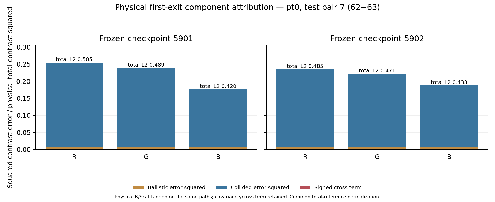

# Worklog63 — Physical ballistic/collided attribution for primary Pair 7 (2026-10-30)

## Authorisation and fixed population

The user explicitly authorised the missing physical component measurement, not a further reconciliation of WL59–62. Start: `5a5df26`, branch `Selective_Recompute`; no branch/worktree change. [Frozen design](../plans/PHYSICAL_COMPONENT_ATTRIBUTION_V1.md) and [protocol](../../experiments/fnto_components63/protocol/components_v1.json) were committed with the tagging/gating/analysis source as **272b13a**, before generation.

Exactly **pt0 / original A2 test fields62 and63**, two independent64M replicas per field, each two32M halves: **eight packets / 256M physical reference photons**. Fresh seeds `630000000+field*100+replica*10+half`. No rest/other geometry, new model, training, B quadrature change, loss/rank/threshold change, coupled solve or successor. Original files, source and checkpoints are read-only.

## Instrumentation and prerequisite gates

The original first-exit estimator and its untagged total sink remain intact. An observational AST transformation inserts exactly one assignment before the existing exit sink: zero-collision iff the current path is in loop step1. All later surviving iterations have already undergone at least one medium collision. Removing the added assignment restores the exact original AST; no original path operation, random draw, weight or control-flow node is changed.

The sidecar sink receives the **same emitted events** after the unmodified original sink. It independently records tagged T, B and Scat first/second moments and exclusive event counts. It has no RNG call and does not alter path tensors. Every primary packet compares its original untagged total/moments to the tagged total on these actual identical sample paths, and separately checks tagged B+Scat closure. Thus Gate A/B consume no extra physical reference samples.

A deterministic scripted-intersection synthetic test also runs the original/tagged walkers from cloned generator states, compares every ray/intersection state, total weights/moments and final RNG state, and checks known one-zero/two-collided events. This is a correctness test, not an additional physical reference population. Three further tests cover covariance/mean scaling and a cancellation case where magnitude-only attribution would be wrong.

Each photon belongs to one mutually exclusive first-exit class, so its raw B×Scat cross moment is exactly0. The statistical covariance is **not zero**: per aggregated half-mean bin, `Cov(B,Scat)=-B*Scat/(N-1)`. Actual variance reconstruction includes this term. Four independent halves average with variance/covariance sums divided by16; independent fields add their contrast variances/covariances. No independent-pixel confidence interval is claimed.

## Generation and completion

The preflight source/input/geometry/checkpoint checks and all four focused tests passed. All eight fixed32M packets passed physical and actual same-path component gates. Gate C qualified T/B/Scat contrasts in every RGB channel. The run completed without failed attempts, packet replacement, budget increase or implementation amendment. Detached process used a new session and lock; server had no compute peer at launch.

A separately committed **report-only** detail exporter is declared after the main attribution measurement: it reads the completed coarse arrays to report absolute component-action errors/powers and contrast amplitude/alignment. It does not sample, infer, fit or change any gate. All main/raw decomposition and replica classification results remain unchanged.

## Final report — COMPLETE, Outcome B (scattering-dominated)

### Implementation Fact

This batch **created** independently sampled physical zero-collision/collided labels. It did not define physical scatter as total minus approximate model B. The original estimator, first-exit path ownership, input proposal/weights and original untagged accumulation are unchanged; extra observational tags and accumulators are isolated in the new source. Reference generation never uses learned predictions or B_model to construct either physical component.

No failed attempt or scientific-protocol amendment occurred. Exactly eight32M packets completed, with two64M replicas for each of the two fields. The 32M execution chunk was fixed prospectively, matching WL59's established policy. The synthetic deterministic path test is not a physical Monte Carlo population and does not add reference samples.

Both frozen 157,024-parameter checkpoints were applied unchanged on the original pt0 geometry. CPU replay agrees with immutable WL59 total outputs to **1.060e-7 / 1.136e-7 relative L2** for seeds5901/5902. The archived geometry's B is unchanged; the model's own Scat is its own total−its own B, while **Scat_ref is independently event-tagged**.

### Measurement — Gate A, semantic/path equivalence

- Stripping exactly one added observational assignment restores the original walker AST, including every RNG call, intersection, path update and weight operation. No RNG call is added by tagging or accumulation.
- The deterministic scripted-intersection original/tagged test compares identical input rays and cloned generator states, both zero/collided event classes, every recorded ray/intersection state, totals/second moments and final RNG state. All pass. It exercises three synthetic rays, not a new physical scene or reference population.
- On **every actual primary packet**, the unmodified original sink and sidecar tagged-total sink see identical emitted paths/events. Maximum relativeL1 difference across eight packets: **9.679e-17** for first moments, **9.161e-17** for second moments. The original float32 response exactly equals its untagged float64 accumulator cast to float32; exclusive tagged exit counts equal original exits for every packet.

Thus the new labels are observational additions to the same sampled process, not a new physical estimator or a different RNG schedule.

### Measurement — Gate B, component and covariance closure

Maximum per-packet relativeL1 discrepancy:

| Closure | Maximum |
|---|---:|
| Tagged B+Scat first moment versus T | 1.918e-16 |
| Tagged B²+Scat² raw second moment versus T² raw second moment | 1.740e-16 |
| Var(B)+Var(Scat)+2Cov(B,Scat) versus Var(T), aggregated half traces | 1.030e-16 |
| Same covariance closure for the final Pair7 contrast | 6.052e-17 |

The raw per-photon B×Scat cross moment is0 by mutually exclusive physical event class. Covariance is retained as negative, not assumed zero. Final contrast covariance traces RGB are **−4.114e-14 / −3.725e-14 / −2.183e-14**. Their numerical effect here is small, but omitting them would be an incorrect uncertainty contract.

All original physical nonnegativity/energy/leak/wrong-side/truncation checks pass for all256M photons. This inherits the established reference implementation's renderer/analytic validation; it is not a new independent-renderer validation or proof of zero systematic bias.

### Measurement — Gate C, independently qualified component precision

Contrast convention throughout: **field62−field63**, material-coordinate flux sums to **1cm /16out**, identical to WL59 Pair7. Both fields and all channels are retained. Conservative SNR uses the independent64M replica difference divided by sqrt2, as in the existing contract. Final-mean SE separately uses all four independent32M half moments with variance/covariance divided by16.

| Physical contrast | SNR R/G/B | Final-mean SE / own contrast R/G/B | Qualified |
|---|---|---|---|
| Total T | 30.698 / 32.967 / 45.600 | .02160 / .01994 / .01485 | RGB |
| Zero-collision B | 458.022 / 477.676 / 477.707 | .001728 / .001714 / .001714 | RGB |
| Collided Scat | 16.071 / 16.832 / 17.360 | .04116 / .03895 / .03883 | RGB |

Every component/channel exceeds SNR3. Error-vector signal relative to the corresponding final-reference SE is about **53.6–54.8 for B** and **22.2–28.7 for Scat**. The large collided error is not an unresolved reference-noise residual. These estimates do not turn pixels into independent samples or two replicas into a confidence interval.

New total actions differ from the old independent WL59 mean by **.00233/.00226/.00234 RGB** relative L2; total contrast differs by **.02884/.02646/.01966**. This is a same-population independent-seed comparison, not a requirement of bitwise equality with historical references. The frozen Pair7 total failure is reproduced with new samples; historical numbers/verdicts are preserved.

### Measurement — Gate D, error-vector decomposition

Define physical `T_ref = B_ref + Scat_ref`, model `T_model = B_model + Scat_model`, and error vectors on the same directional contrast:

```text
E_total = E_B + E_Scat
||E_total||² = ||E_B||² + ||E_Scat||² + 2<E_B,E_Scat>
```

Every entry below is divided by the **same physical total-contrast norm squared**; component error norms in the following table also use that common total norm. No attribution is inferred from component flux magnitudes.

| Seed | RGB channel | B squared error / ||T_ref||² | Scat squared error / ||T_ref||² | Signed cross / ||T_ref||² | Total squared error / ||T_ref||² |
|---:|---|---:|---:|---:|---:|
| 5901 | R | .006264 | .248152 | +.000186 | .254602 |
| 5901 | G | .006547 | .232320 | +.000050 | .238916 |
| 5901 | B | .007545 | .168506 | +.000040 | .176092 |
| 5902 | R | .006264 | .228683 | +.000076 | .235023 |
| 5902 | G | .006547 | .215177 | +.000076 | .221800 |
| 5902 | B | .007545 | .180067 | +.000066 | .187678 |

| Seed | B error / total-reference norm R/G/B | Scat error / total-reference norm R/G/B | Total directional relative L2 R/G/B |
|---:|---|---|---|
| 5901 | .079144 / .080911 / .086865 | **.498149 / .481996 / .410494** | **.504581 / .488791 / .419633** |
| 5902 | .079144 / .080911 / .086865 | **.478208 / .463872 / .424343** | **.484791 / .470956 / .433218** |

B has a real, resolved approximation error: its own physical B-contrast relative error is **9.26–9.39%**. It is not exact or exonerated in every respect. Nevertheless, collided squared error is **22.3–39.6×** larger than B squared error on this qualified pair.

### Observation — dominance, alignment and cancellation

Of total squared error, the raw decomposition accounts for:

- **95.69–97.47%** from the collided squared-error term;
- **2.46–4.29%** from the ballistic squared-error term;
- **+0.021–0.073%** from the signed cross term.

The cross term is small and positive, not a hidden large cancellation. B/Scat error-vector cosine is only **.00057–.00236**, nearly orthogonal. Scat-error alignment with total error is **.9783–.9876**; its signed projection share is **95.70–97.50%**. Both the energy identity and projection accounting support the same conclusion.

The predeclared descriptive dominance convention requires squared component error>=4× the other, alignment with total, and cross magnitude<=half the dominant squared error. **Every RGB channel for both checkpoints and all four reference-replica field combinations gives Outcome B, scattering-dominated.** This is six mean-reference model/channel cases plus24 replica cases, not30 independent experiments. Moment corrections including the negative B/Scat covariance leave the conclusion unchanged; their ratios are not treated as unbiased or confidence intervals.

As component arithmetic only, removing B error while holding the present learned Scat output fixed would still leave total-normalized errors **.410–.498**, above the original .25 Pair7 bound. This is not an implemented B replacement: changing B/beta in the actual architecture can also affect the remaining scattering budget.

### Diagnostic observation — the collided directional response itself is wrong

A report-only read of the completed component arrays distinguishes action magnitude from directional response:

| Seed | Predicted Scat contrast norm / physical Scat contrast R/G/B | Centered Scat contrast correlation R/G/B | Centered slope R/G/B |
|---:|---|---|---|
| 5901 | .3661 / .3406 / .3009 | .3115 / .3360 / **−.1365** | .1138 / .1127 / **−.0409** |
| 5902 | .2918 / .2734 / .2997 | .4296 / .4559 / **−.2661** | .1249 / .1246 / **−.0799** |

Absolute collided-action relative L2 on the individual fields is only **.0490–.0711**, while collided **directional-contrast** relative error against its own physical contrast is **.909–1.116**. Physical Scat action power is near .98 in red, .89 in green and .53–.54 in blue, and the model approximates those powers reasonably; matching power/absolute norms does not preserve this directional difference.

The observed defect is not just a uniform scalar under-amplitude: the signed spatial/angular pattern is weakly aligned in R/G and anti-aligned in blue. Negative blue correlation concerns a **signed difference of nonnegative actions**, not negative emitted energy or a passivity violation. These are measurements of this frozen response, not an information-theoretic rejection of the representation class.

### Interpretation — what is now isolated

**The responsible measured physical contribution is learned collided transport.** The previous ambiguity between a dominant direct ballistic error and a learned-scattering error is resolved for this pair. A significant B/Scat cancellation explanation is contradicted by the tiny cross term.

| Candidate explanation | Evidence | Attribution |
|---|---|---|
| Ballistic B approximation dominates Pair7 failure | B error is resolved but only .079–.087 on the common norm, about2.5–4.3% of squared error | **Not dominant**; secondary error remains |
| Learned collided response dominates | .410–.498 error on common norm;95.7–97.5% signed projection share; both seeds/all replica choices agree | **SUPPORTED — Outcome B** |
| Strong error interaction/cancellation causes the total failure | Cross term only +.021–.073% of total squared error, near-orthogonal error vectors | **CONTRADICTED as predominant explanation** |
| Component-reference precision/physical semantics prevent attribution | Gates A–C pass; covariance and total closure verified; Scat error SNR22–29 | **Not the blocker for this measurement** |

**Specific numerical/physical defect:** a physically incorrect collided directional response is localized, including under-response and wrong signed blue pattern. No coding bug, reference-semantic error, unit/normalization error or specific optimization defect is isolated. It would be inaccurate to call the result a proof that angular rank, spatial capacity, noisy labels or optimizer choice is the cause.

The observed Scat path includes learned coefficients, geometry features, global normalization and the `(1-beta_model)` remaining-budget interface. A small direct B output error does not logically eliminate every indirect effect of that interface on learned Scat. No counterfactual beta/normalization or fitting intervention was performed. Those upstream mechanisms remain confounded; no component is redefined to force attribution.

### Whether one bounded correction is justified

The evidence is sufficient to choose **collided directional fidelity as the demonstrated correction target**, and rules out treating direct B quadrature improvement alone as the evidenced remedy for Pair7. It is **not yet sufficient to select one specific corrective recipe** among clean collided-contrast supervision, objective changes, optimization changes or a representation change. A later batch could be bounded to that target, with held-out Pair7 retained for evaluation; using these held-out labels to tune a model would change its scientific role.

No correction is implemented or automatically authorised here. The component-localization result does not prove that a fixed-family correction can meet the full primary contract, nor that a new architecture is required.

### Unresolved Question

Why the frozen learned collided operator fails to learn the needed directional mapping remains unresolved: input/angular mixing, nonlocal spatial/kernel constraints, geometry conditioning, supervision precision, optimization and the remaining-budget/normalization interface are not separated by event tagging. The independently tagged response is now available to design a future controlled intervention, but it is not itself a replacement operator.

This batch covers **one geometry and one pre-existing qualified directional pair**. It does not attribute the whole primary blue deformation error, all other pairs, full-scene GI, global bending/self-contact or sharp glossy physics. It does not close WL56's independent physical-GI floor. Original WL59 quality verdicts remain unchanged.

### Architecture Verdict

No K/C ownership, Rule/State execution, model capacity, checkpoint, quadrature, loss, training, threshold or production change. No architecture adopted or replaced; no coupled solve or successor. Living documents remain unchanged because a measured correction target is not an accepted architecture decision. The batch closes with **Outcome B: scattering-dominated qualified Pair7 failure**, with a specific component localized and its learning/representation cause still unidentified.

### Reproducibility and resources

- Reference/tagging/protocol and Gate A–D analysis: **272b13a**, committed before any final reference generation. Original reference source files are unchanged; source AST and full code/data/checkpoint hashes are recorded in [preflight.json](../../results/fnto_components63/preflight.json).
- Report-only component detail and exports: **f11fb98**. Plot clarification/annotation margins only: **59de951**; original reviewer artifacts retained under `review_versions/f11fb98`. The final footer explicitly says B/Scat are tagged on the **same paths**, not statistically independent components.
- All four focused tests pass. Same-path primary total/second-moment comparisons, exclusive-event counts, physical controls and covariance closure are executed on every packet. There are no failed attempts to replace or hide.
- Field62 SHA `857dee78f555db377dde3d18688b66ab588c78cd6755e3c7994398e996b02c7c`; field63 SHA `bf0419116701c31baf732d3b560312e89f842aa3aeed35aa42c7752cf8cd1158`. Exact pt0 data SHA and canonical geometry/derived-feature checks are in the protocol/preflight.
- Frozen checkpoints remain P_5901 SHA `59685b214bdf1f81079dcd56fe7a61173b90640b3c5c9fb8b3f14094729aaad6` and P_5902 SHA `c92e4fda4bbe9cf5569d55c45a2881d95eaa58df3896748088d060b55f1aab3f`. Large original action files were independently rehashed and match WL60's identities; [original_actions_identity.json](../../results/fnto_components63/original_actions_identity.json).
- LabServer69 RTX3090 24GB; generation uses the original Python/Torch/NumPy/CUDA environment recorded in preflight. **Reference stage22.296s**, eight individual packet timings in [reference_complete.json](../../results/fnto_components63/reference_complete.json). Peak allocated GPU **9,742,388,736B**, reserved **10,599,006,208B**; CPU high-water **1,541,908KiB**. CPU frozen analysis **3.529s**. These are reference/diagnostic costs, not a learned dynamic-GI speed claim.
- Full half actions, component first/second moments, original total moments, tags/counts/RNG digests and receipts remain under `~/rest_components63/halves/`. [coarse_components.npz](../../results/fnto_components63/coarse_components.npz) preserves reviewer-scale half moments, reference component variance/covariance and frozen model components. All eight seeds/counts/hashes are listed in reference_complete.json.
- [analysis.json](../../results/fnto_components63/analysis.json) owns complete per-channel/seed/replica decomposition and Gate C precision; [component_detail.json](../../results/fnto_components63/component_detail.json) owns report-only action/contrast detail. [Mean-reference table](../../results/evaluation/63/component_attribution_all.csv), [all replica variants](../../results/evaluation/63/replica_attribution_all.csv), [review manifest](../../results/evaluation/63/manifest.json) and [batch provenance](../../results/fnto_components63/provenance.json) provide reproducible identities.



```sh
# Historical execution: use a fresh isolated root with the committed snapshot/dependencies.
COMP_ROOT=$HOME/rest_components63 ORIGINAL_ROOT=$HOME/rest_persist_v1 \
  COMP_COMMIT=272b13a bash $HOME/rest_components63/source/launch.sh
# Report-only; use fresh output paths and the completed coarse arrays:
python detail63.py --root <completed-root>
python review63.py --root <completed-root> --out <new-review-directory>
```

Do not rerun or overwrite the completed evidence. **The requested missing physical component measurement is complete; no subsequent correction has been performed.**
