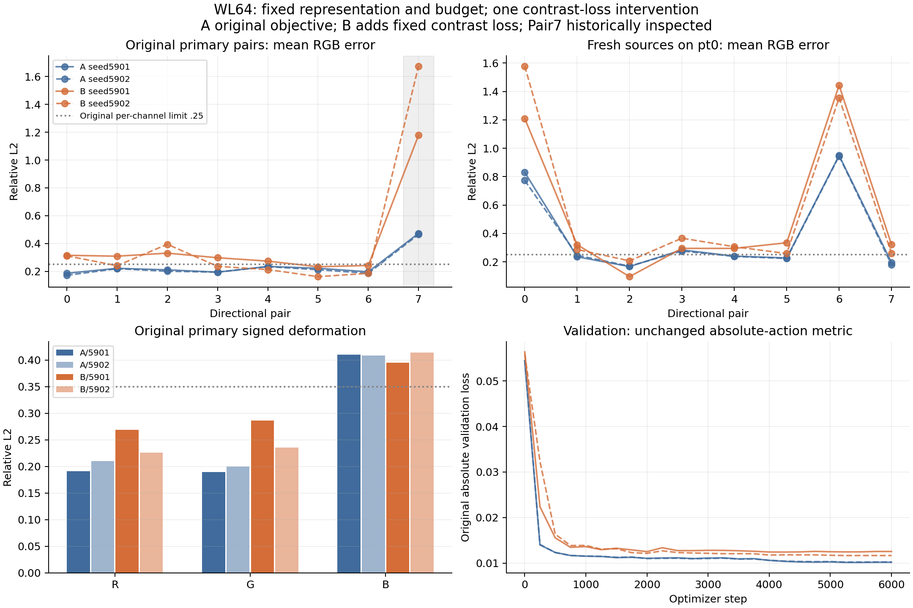

# Worklog64 — Fixed-family directional-contrast supervision

## 2026-10-30 — Authorisation and prospective execution record

The user's explicit bounded brief authorises one objective intervention after completed WL63. Starting HEAD `bad10d5`, current branch `Selective_Recompute`; no worktree or architecture replacement. Read Architecture/research topic/roadmap, WL59 protocol/training/evaluation/provenance, WL60–62 attribution and WL63 tagged component evidence. [Frozen design](../plans/DIRECTIONAL_CONTRAST64_V1.md) and [protocol](../../experiments/fnto_direction64/protocol/direction_v1.json) own the prospective rules.

Implementation scope: original P model, parameters, B, input/output basis, geometry, F/S, labels, original objectives, seeds and optimizer budget preserved. A/B isolated under `~/rest_direction64/arms`; only B adds explicit directional-contrast supervision. Original sources and checkpoints are read-only. Calibration uses training values only and will be committed numerically before training. A fresh eight-pair source population is predeclared for evaluation-only on known pt0; Pair7 remains a historically inspected diagnostic.

Execution pending calibration/tests, final numeric freeze, independent-reference qualification, four controlled training runs, unchanged original evaluation/cost, and component/comparison reporting. No scientific outcome exists at this entry. No coupled solve or automatic successor is authorised by recording this plan.

### Pre-training implementation-test correction

Initial setup stopped before producing calibration or training: a focused identical-target test required bit-exact zero from two separate GPU atomic aggregations. Direct diagnostic measured 9.95e-14 GPU normalized residual versus exact0 on CPU float64. This is aggregation roundoff, not a changed objective. Repair the test to require CPU-double exact0 and GPU residual<=1e-10; retain the original failed setup log. No scientific loss, weight rule, threshold or budget changed.

### Numeric objective frozen before training

Training-only calibration and focused tests pass. Fixed coarse/fine16 eta = **0.0020228057947454018 / 0.02429031329894211**; lambda = **1.4493619017035815**, selected once by the prospectively committed rule. No candidate trained and no held-out model outcomes inspected. Exact compatible original rest r0 train tensor equality is verified; all original source/data/checkpoint identities recorded in [calibration.json](../../results/fnto_direction64/pretraining/calibration.json). Calibration implementation commit `7594e35`.

All8 train pairs have equal spatial flux and distinct angular fields. Pair-swap and normalization controls pass; baseline weight0 returns the original loss tensor, real-model gradient comparison max absolute difference9.47e-10 (GPU atomic roundoff). CPU-double exact-target loss0; GPU residual9.13e-14. Original physical controls pass: zero0, linearity5.41e-8, max column sum0.927172, cache error6.39e-8; parameter count157,024. No runtime source or architecture change. Initial failed zero-equality assertion remains in `setup_attempt0.log`. Numeric freeze and comparison source are committed before launching any training.

### Prospective independent-reference gate completed

Execution source/numeric freeze `05bb858`. Before any training, fixed generator seed6408103 produced16 retained fields, hashes disjoint from all original splits. Physical generation completed64 packets ×32M = **2.048B photons**, **167.693s** reference-stage elapsed. All physical/tag controls pass. All24 total and all72 T/B/Scat contrast cells qualify at SNR>=3; minimum total contrast SNR **48.5593**. These are fresh sources on known pt0, not fresh geometry or a production scene. References are evaluation-only. No sampling extension, field rejection or weight adjustment.

Original rest compatible single-label contrast noise relative to midpoint contrast ranges coarse **0.05359–0.45672** (median0.12906), fine16 **0.10578–1.08350** (median0.28634). These are descriptive training-label uncertainty, not clean deformed-target qualification or causal proof. Original labels remain unchanged for both arms. AST controls additionally verify the original static/deformation forward/loss/backward block, absolute loss and validation are identical in train64.

### Reporting measurements pinned during A training, before candidate training

Report-only source adds post-training rigid/no-op/source-swap/physics checks on each trained checkpoint and exhaustive final native-split pair risk (rest+12 training geometries; rest+2 validation geometries, all8 pairs). These measurements use original r0 targets, are explicitly noisy/unqualified diagnostics, and cannot select checkpoints or change the frozen objective, rules or 6,000-step budget. The originally committed comparison and numeric freeze remain `05bb858`; additional report execution follows the complete serial scientific chain without GPU contention.

### Precision sensitivity in report

Before held-out candidate outcomes exist, report-only export also specifies all4 even/odd-field independent-replica assignments for the fresh total contrast A/B mean-error ratio. This is sensitivity reporting, not a confidence interval or a replacement for the already frozen mean-reference gate. No training/objective/source population changes. Final noisy original training/validation pair risk is reported alongside held-out metrics, without interpreting original r0 as a clean component reference.

### Post-training measurement harness correction (no scientific rerun)

All four fixed6,000-step training runs and the frozen original A/B evaluation/cost/comparison completed. The extra trained-rigid helper then stopped with `KeyError: beta`: it mixed an inherited stored rest geometry's historical raw signature with a newly generated canonical-signature rigid geometry lacking B/beta. Their differing cache identities sent the helper through the non-rigid update path. This is the already known raw/canonical signature distinction (WL61); no original runtime, checkpoint, label or quality measurement is changed.

Repair only this helper to construct both rest and rigid geometry through the same current geometry constructor, exactly as WL59's archived final trained-rigid control (`results/fnto_persist59/final/validation/5c25f3c/verify_rigid.py`). Preserve `invariants64_attempt0.log` and `finish_attempt0.log`. The frozen scientific chain remains complete/negative and is not repeated; only previously uncompleted post-training measurements resume. No threshold is relaxed.

### Report-only duplicate cost-row correction

Visual QA of the completed report passes. Inspection found the report export appended the whole unchanged cost comparison list once per seed, duplicating every cost row twice. Raw cost workers/medians/bootstraps and every quality result are unaffected. Repair export to append only the current seed's existing records. Preserve review_v1 and its manifest, original export source and first provenance/bundle; generate review_v2 with32 unique arm/seed/edit/query rows. No measurement or scientific criterion is repeated or changed.

### Environment-metadata collection repair

The first final collector stopped while asking the existing uv-managed venv for `python -m pip freeze`: pip is not installed in that venv. No provenance JSON or bundle was written, so no incomplete collection is treated as verified. Preserve `collect64_attempt0.log`; read installed distribution names/versions through standard-library `importlib.metadata` instead, without installing/upgrading packages. Repeat final unchanged-input/hash collection after report_v2; no training/reference/evaluation rerun.

## 2026-10-30 — Completed bounded result: NOT SUPPORTED

### Implementation Fact

Executed exactly one intervention: unchanged WL59 P response with the original action +0.25 deformation objective (A), versus that objective plus the fixed directional contrast term (B). Both arms use seeds5901/5902, original r0 labels, original optimizer/schedule, 6,000 steps and final-checkpoint selection. Architecture,157,024 parameters,16 incoming/64 outgoing bins, geometry, ballistic B, physical first-exit semantics and F/S runtime are unchanged. Pair indices select tensors offline; no source/pair ID enters the operator. The new term supervises **total response contrast**; only the existing collided branch is trainable. It is not independently tagged Scat training supervision, and fixed B error can remain in the residual.

Scientific code/comparison and numeric objective were frozen in **05bb858**, before reference generation and all four fits. No sweep, clean-label intervention, extra step, alternate candidate, checkpoint selection or coupled GI occurred. Report-only corrections described above preserve their failed/earlier versions.

### Measurement

Original pt0 primary directional errors below average all8 pairs ×RGB; failure counts use the unchanged per-cell0.25 limit. All24 original and fresh contrast cells are reference-qualified. Pair7 is historically inspected.

| Seed | Original mean A → B | Failed original cells A → B /24 | Original pairs0–6 mean B/A | Fresh8-pair mean A → B | Blue deformation error A → B |
|---|---:|---:|---:|---:|---:|
|5901|0.24265 → **0.39757**|5 → **17**|1.3642|0.39105 → **0.53935**|0.41012 →0.39474|
|5902|0.23548 → **0.42735**|4 → **12**|1.2295|0.38154 → **0.57732**|0.40866 →0.41420|

The prospectively required ≥10% improvement fails in both seeds. Original mean directional error increases **63.8% /81.5%**; fresh error increases **37.9% /51.3%**. Fresh failures increase15→17 and13→17 /24. Four independent even/odd reference-replica assignments give fresh B/A mean-error ranges **1.37853–1.37984 /1.51226–1.51380**: the negative direction is not sensitive to these reference choices. These ranges are sensitivity checks, not confidence intervals.

There are local improvements, which are retained: original cells improve1/24 and7/24 (the other23/17 regress); fresh cells improve4/24 and0/24. Seed5901 blue deformation error improves slightly, but remains above0.35. R/G deformation errors increase from0.19080/0.18971 to0.26919/0.28642 (seed5901), and0.20989/0.20018 to0.22563/0.23584 (seed5902). R/G still pass their original criteria; **blue fails in both arms and seeds**. Correlations/slopes and every F/S result are retained in [deformation_all.csv](../../results/evaluation/64/deformation_all.csv).

Original primary static gates pass for every model and both policies, although numerical accuracy regresses: pt0 coarse mean error across seeds/RGB ranges A0.06152–0.06677 versus B0.07084–0.07830; fine16 A0.10172–0.11148 versus B0.11531–0.12038. Rest shows the same pattern. Fresh coarse absolute total errors also increase (A roughly0.0995–0.1025, B0.1163–0.1277); these fresh coarse-only numbers are diagnostics, not a retroactively added full static gate. [absolute_all.csv](../../results/evaluation/64/absolute_all.csv) contains every original primary/diagnostic pose, RGB and resolution.

**Scattered response:** fresh mean own-Scat contrast error increases **0.95753→1.21993 /0.94629→1.30252**. On historically inspected Pair7, the physical tagged-reference comparison is:

| Seed | A Scat relative contrast error RGB | B Scat relative contrast error RGB | B Scat contrast correlation RGB |
|---|---|---|---|
|5901|0.952 /0.944 /1.080|**2.077 /2.639 /2.850**|−0.797 /−0.829 /−0.615|
|5902|0.913 /0.908 /1.116|**3.622 /3.145 /3.969**|−0.873 /−0.811 /−0.639|

B's Pair7 Scat contrast norm/reference norm becomes1.191/1.750/2.129 and2.717/2.279/3.261: simply increasing contrast amplitude did not recover its signed spatial/angular pattern. Ballistic construction/output is shared and fixed. Full per-pair/RGB T/B/Scat errors, amplitude and correlation are in [directional_components_all.csv](../../results/evaluation/64/directional_components_all.csv); this compares new checkpoints to existing/new qualified tags without repeating WL63's completed attribution.

**Physical/computational controls pass:** original held-out zero/linearity/nonnegative/passive/cache/F-S checks pass, with primary max relative F/S L1≤9.46e-8. Extra trained checks pass4/4: zero0, max column sum≤0.999388, linearity≤7.25e-8, cache error≤6.63e-8, rigid relative L1≤2.42e-8, no-op≤2.49e-8 with identical cache object and full rigid raw retention. [trained_invariants.json](../../results/fnto_direction64/trained_invariants.json) owns exact values. This covers matched current canonical cache identities; it does not claim interoperability with the inherited raw-signature cache encountered in the failed helper.

**Training/validation:** final exhaustive original noisy training-pair objective is A0.19158/0.19187 versus B0.09571/0.09565 (about50% lower). Native validation-pair objective instead rises A0.08125/0.07857→B0.14099/0.09983. The unchanged absolute validation loss ends A0.01020/0.01026 versus B0.01257/0.01168. Thus the new term has a measurable training effect without a held-out fidelity gain. Histories are [training_history.csv](../../results/evaluation/64/training_history.csv); exhaustive per-geometry/per-pair risks are [final_pair_risk.json](../../results/fnto_direction64/final_pair_risk.json). Original r0 pair-risk values are noisy diagnostics, not clean physical accuracy gates or convergence proof. Logged gradient norms remain below the original clip1; sparse logs do not certify every optimizer step.

### Observation

The reproduced A matches the preserved WL59 result: maximum per-cell primary directional-score drift is4.30e-5 /1.15e-4; original failure counts and blue failure are retained. B's regressions are far larger than this numerical repeat variation. Original action/deformation backward code and validation AST are identical, training inputs/checkpoints/source hashes are preserved, and the intended contrast objective lowers its own training risk. No concrete evidence of an accidental architecture/data/reference change explains the negative comparison.

The result is consistent across both model seeds, original pairs0–6, historically inspected Pair7, the independently fixed new inputs, component diagnostics and reference-replica variants. Some cells improve, but neither the predeclared directional-improvement rule nor complete-fidelity rule passes. The fresh sources test input generalization on the **same pt0 geometry**, not new geometry, scenes, materials or external-baseline superiority.

### Interpretation

**This specific fixed objective intervention is NOT SUPPORTED as a fidelity correction.** With representation, original training population, labels, optimizer steps and capacity fixed, explicit contrast supervision lowers seen-pair loss but worsens physical held-out directional behavior and Scat pattern. Missing an explicit term was therefore not a sufficient correction under this recipe/budget. This does not prove that every possible contrast objective fails, that the existing representation is adequate/inadequate, or that training noise is the cause.

Lower training risk together with worse validation/test risk is consistent with an objective-induced fit/generalization tradeoff. It does not isolate label-noise fitting, source/geometry coverage, normalization/weight choice, optimization or shared positive-kernel constraints. No capacity, weight or label follow-up is selected from this result.

### Unresolved Question

Original supervision remains precision-limited: compatible rest single-label contrast noise is5.36–45.67% coarse and10.58–108.35% fine16, with correlated field errors from the shared original operator. Deformed-label precision/bias is not independently qualified. The one fixed training-only normalization/weight does not remove these limitations. WL63 tagged Pair7 and the new tags were never training labels, loss-weight inputs or checkpoint-selection signals. The underlying learning/representation cause, complete blue deformation cause, broader geometry/contact validity and coupled-GI reference floor remain unresolved.

### Architecture Verdict

| Separate question | Adjudication |
|---|---|
|Directional fidelity improvement|**NOT SUPPORTED**; both original/fresh mean error and failure counts worsen.|
|Static/deformation preservation|Original static **gates preserved**, with numerical static regression; R/G deformation errors worsen, blue still fails both seeds. Complete fidelity is not preserved/achieved.|
|Transfer beyond inspected Pair7|**NOT SUPPORTED**; original pairs0–6 and fully qualified fresh8-pair population worsen in both seeds.|
|Training-objective hypothesis|The tested fixed intervention **fails as a correction**, despite ~50% lower noisy training-pair objective. No general objective-family falsification.|
|Remaining supervision/representation confounds|**UNRESOLVED**; noisy/bias-limited labels, coverage, weighting, optimization and joint family constraints are not causally separated.|
|Eligibility for coupled GI|**INELIGIBLE** for A/B, both seeds and F/S. Coupled GI skipped at unchanged K gates.|
|Valid quality/cost advantage|**NONE demonstrated**; poorer required fidelity and higher offline training cost; raw intrinsic timing cannot establish a quality-matched GI advantage.|

No representation, K/C ownership, F/S mechanism or physical-reference change is adopted. Computational F/S equivalence remains separate from physical fidelity. General Rule–State viability remains INCONCLUSIVE. This bounded negative closes the candidate; no automatic successor, production replacement, TransGI claim, global-deformation/contact claim or new hypothesis follows. Living architecture/research documents are unchanged because no new long-term contract/architecture decision was adopted; this experiment's history belongs here.

### Reproducibility

- Scientific freeze **05bb858**; calibration implementation **7594e35**, numeric training-only eta/lambda committed before all fits. Report/component exports **0ccef6e**, rigid-helper correction **f208594**, report cost-row correction **d826548**, final environment collector/report tree **28c2444**. Git history preserves initial failed helper/setup/collector code and logs. All four final checkpoints are retained under [arms](../../results/fnto_direction64/arms); exact hashes are in [comparison.json](../../results/fnto_direction64/comparison.json) and [provenance.json](../../results/fnto_direction64/provenance.json).
- LabServer69 RTX3090 24GB; existing Python/Torch2.3.1+cu121/NumPy1.26.4 venv, TF32 off,8 Torch threads. Full CPU/GPU/driver/package environment, immutable source manifests and52 rehashed original input identities are recorded in provenance. All original input/source/checkpoint hashes match at closure. Existing WL59–63 files are unchanged.
- New input seed6408103, fixed retained fields48:64, all field hashes disjoint from original splits; [independent_population.json](../../results/fnto_direction64/independent_population.json). All64 physical packets ×32M photons pass; total2.048B, generation inner elapsed167.693s, max allocated GPU10,377,913,344B. All24 total/all72 component contrast cells qualify; minimum total SNR48.5593. Full packet seeds/RNG digests/stats/hashes are in [independent_complete.json](../../results/fnto_direction64/independent_complete.json). Coarse packet moments and refs are in [independent_reference.npz](../../results/fnto_direction64/independent_reference.npz).
- Final training timers: A615.62/618.23s, B824.83/823.04s; B/A **1.3398/1.3313**. Process-stage wall times including startup/loading are620.25/622.64s versus829.35/827.60s. A includes the extra no-grad paired measurement; optimizer/action/deformation gradients remain original. Equal6,000-step budget does **not** mean equal GPU time. All four peaks are4,603,262,976B allocated. [training_cost.csv](../../results/evaluation/64/training_cost.csv).
- Unchanged actual lifecycle suite:16 fresh workers total,7 repetitions each, query counts1/4/16/64, before/after GPU peer checks all uncontended. Raw dent S/F across query counts: A0.99105–1.00156, B0.97569–1.00127; rigid A0.71668–0.78173, B0.71426–0.77805. At64 queries dent F≈0.434–0.438s/S≈0.433–0.436s; rigid F≈0.468–0.472s/S≈0.362–0.369s. These are intrinsic resident-state update/query costs, excluding unexecuted C/solve/readout. [cache_lifecycle_cost.csv](../../results/evaluation/64/cache_lifecycle_cost.csv) has32 unique comparisons; raw worker records/bootstraps/initial setup/memory are under each arm's `out/cost*`.
- Reviewer report_v2 differs from v1 only by removal of duplicated report cost rows:32 unique rows, every scientific summary unchanged, PNG bit-identical; [report_v2_validation.json](../../results/fnto_direction64/report_v2_validation.json). Earlier report/source versions and failed logs are preserved. Final report manifest and small-artifact SHA checks pass locally; downloaded bundle SHA `3119c3a0b2797100a3519113cdae5e3fa11c1bd10ac65d82ba575552088479aa` (30,581,163B).
- Large original/new action tensors and all full tagged halves remain immutable under `~/rest_persist_v1` and `~/rest_direction64` on LabServer69, identified by final provenance. Reviewer arrays, new fields/checkpoints, logs and tables are retained locally. Use a fresh compatible home/isolated root to reproduce; do not overwrite completed evidence. No later scientific run remains queued.

[Complete per-cell original directions](../../results/evaluation/64/directional_original_all.csv) · [components/fresh directions](../../results/evaluation/64/directional_components_all.csv) · [machine summary](../../results/evaluation/64/summary.json) · [review manifest](../../results/evaluation/64/manifest.json).

**Completion answer:** with the fixed representation/population/capacity/6,000-step budget used here, this one predeclared directional-contrast objective produces **no physically qualified fidelity improvement**. The experiment is complete with a negative result; no successor is selected.

#### Pair-risk averaging clarification

The report's0.19158/0.19187→0.09571/0.09565 training numbers average the13 native geometry rows uniformly;0.08125/0.07857→0.14099/0.09983 validation numbers average rest plus the two validation geometries. These are component-risk diagnostics, not the full optimizer objective or the unchanged absolute validation metric. Applying the actual contrast term's0.5 rest +0.5 mean-current weighting gives training A **0.19183/0.19221**, B **0.09403/0.09380**. Restricting validation pair diagnostics to the original va0/va1 geometries gives A **0.08056/0.07789**, B **0.14007/0.09918**. The rest/validation row is an additional diagnostic only. Both aggregations show lower seen-pair risk and worse validation-pair risk; no gate or conclusion changes.
