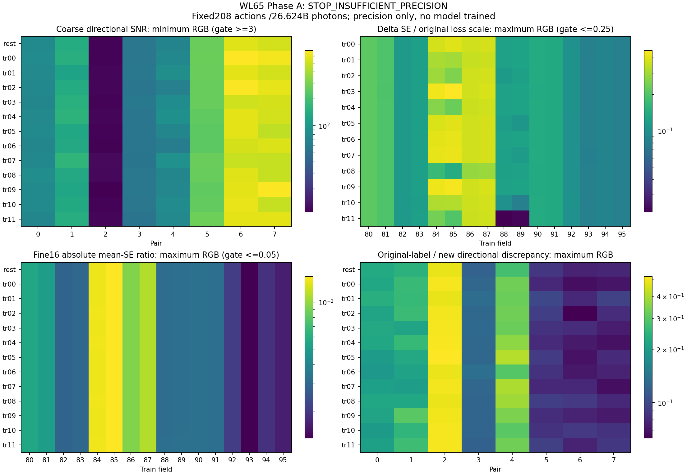
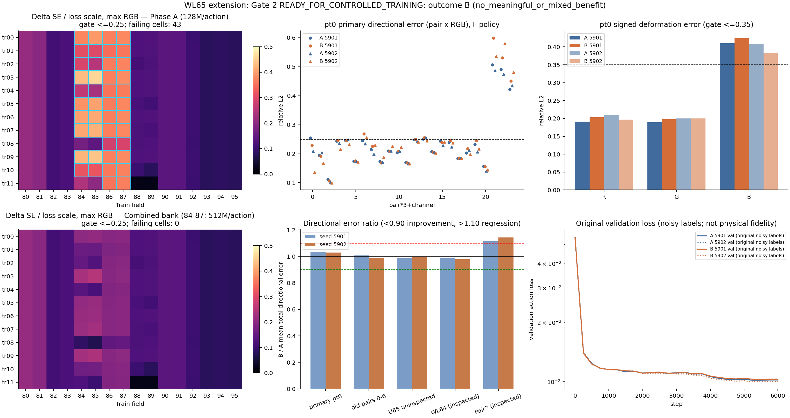

# Worklog65 — Partial clean-supervision A/B (2026-10-30)

## Phase A — Authorisation and prospective reference preparation

The user's explicit brief authorises **only pre-training reference generation/qualification** before2026-10-31 14:00KST. This Worklog owns the whole eventual Clean Supervision experiment; completing Phase A does not complete that research experiment. Starting HEAD `002c625`, branch `Selective_Recompute`; no branch/worktree change. Read current living documents, WL59 model/training/reference protocol, WL60–61 supervision findings, WL63 physical component result and WL64 negative objective intervention. Do not repeat those completed diagnostics.

[Plan](../plans/CLEAN_SUPERVISION65_V1.md) and [fixed protocol](../../experiments/fnto_clean65/protocol/clean_v1.json) define208 original training actions,832 independent32M packets /26.624B photons, exact source/label identities, covariance and precision gates. All13 original training geometries and all16 original directional fields80–95 are retained. Phase B is **not authorised**: model157,024 parameters, original96-field sampling/partitions, action+.25delta objective, optimizer/6,000steps/checkpoint, B and F/S must remain unchanged in any separately authorised continuation.

Feasibility before generation: historical32M timings1.980–3.096s project32–43min packet time, conservative40–90min total. Prior GPU peak10.38GB; budget16GiB/24GB. Raw packets49.073GB plus labels/variance4.907GB and small reduced outputs; reserve60GiB, require100GiB free. Server read-only inventory shows idle GPU and~1.2TB available. Unlike WL61's2M chunks, this experiment fixes32M chunks prospectively. No physical photon or model execution has occurred at this entry. New samples use one field per action, so no field-mixture dilution of the proposed photon budget.

Preflight/tests and actual identities/resource estimates will be committed before generation. Sufficient precision cannot be guaranteed for weak differences: the unchanged original delta loss floor provides a separate uncertainty scale, while pure delta SNR remains explicitly reported. No field filtering, count extension, changed loss or automatic training is authorised.

### Phase-A preflight passed before any reference generation

Preflight/test source **c8a3648**. All7 focused CPU checks pass: exclusive-bin covariance/grouping, four-half variance/16, shared-rest cancellation, original weak-delta loss floor, observational accumulator preservation/restoration, all8 original pairs retained and832 distinct seeds. All96 train-field arrays exactly match original WL57 lineage. All13 raw legacy/current canonical geometry identities, derived features and parent correspondence pass; original label/physical source/checkpoint hashes match.

Available disk **1,319.25GB**; deadline about **20.10h** away at server preflight, versus conservative40–90min execution estimate. GPU had no external compute peer. Minimum RGB source-proposal ESS fraction across fixed fields is **0.971386**, or≥31.084M source-weight effective samples per32M half. This is before transport/absorption and is **not** exit-action ESS; physical first/second moments determine actual uncertainty. No cross-field mixture is used. The exact proposed208-action/26.624B-photon contract is feasible; no costed alternative or scope/budget substitution is needed.

[preflight.json](../../results/fnto_clean65/preflight.json), tests and preflight log are committed before generation. No physical reference photon or model execution preceded this evidence. The subsequent generation commit changes evidence/Worklog only; protocol/source bytes remain the preflight-verified version. Proceed only with fixed Phase A; Phase B remains unauthorised.

### User steering — event-only waiting

The user requested stopping conversational progress polling to avoid token waste. Leave the existing server generate→analyze→report chain untouched. Install a token-free server stage observer and local SSH→`codex queue` bridge for this existing thread. Notify only on stage completion or failure; no periodic agent turns/progress reports. Stage callbacks must return idle until a real completion/error needs action. No new agent or Phase B is created. The frozen scientific source directory remains unchanged; watcher helpers live outside it.

### Terminal Stage events received

Event-only callbacks confirm generation832/832 packets /26.624B photons, physical pass; analysis and reviewer report completed. Frozen readiness is **STOP_INSUFFICIENT_PRECISION**: all624 coarse/fine16 absolute cells and all312 coarse directional cells pass, but107/576 original-loss-scaled delta cells fail. No photons, fields, gates or labels are changed after this outcome. Final immutable provenance collection/download runs once in the background and queues this same thread only on terminal completion/error; no conversational polling. The complete Clean Supervision research experiment remains open and Phase B unauthorised.

## Phase A terminal report — STOP_INSUFFICIENT_PRECISION

Phase A is finished; **the full Clean Supervision A/B experiment is not complete**. No model has been trained/evaluated and no Phase B is authorised or queued. This status is a fixed-budget precision stop, not an invalid-reference, resource or model-performance verdict.

### Implementation Fact

Completed the exact proposed population: original train fields80–95, all8 pairs, rest plus all12 original training dents =**208 actions**;2 independent64M-photon replicas/action, each2 independent32M halves =**832 packets /26,624,000,000 photons**. Every packet passed the original physical checks and observational response/second-moment equality checks. No failed packet was replaced; no field, geometry, count, chunk, estimator, loss or model was changed.

All96 original train-field bytes and all13 original geometry/correspondence contracts match. Physical K/C, first-exit semantics, B/remaining budget,157,024-parameter P representation, original action+.25deformation loss, optimizer/6,000-step/final-checkpoint rule,96-field distribution/partitions and F/S remain unchanged. The full16-field mean/variance bank is stored separately on the server; original training files were never patched. Other80 fields remain original in the prospective A/B plan. No held-out Pair7, WL64 fresh fields, test label or model prediction selected or weighted these references. Historical timing/memory metadata were used for feasibility only.

### Measurement

These are Monte Carlo uncertainty norms perRGB at the declared spatial/angular aggregation, not model prediction errors or confidence intervals.

| Frozen readiness check | Observed | Gate | Result |
|---|---:|---:|---|
|Coarse absolute final-mean SE/action norm, maximum624 cells|0.003700 (0.370%)|≤0.01|624/624 pass|
|Fine16 absolute final-mean SE/action norm, maximum624 cells|0.014628 (1.463%)|≤0.05|624/624 pass|
|Coarse directional conservative replica SNR, minimum312 cells|10.9806|≥3|312/312 pass|
|Coarse directional final-mean SE/contrast norm, maximum|0.061926 (6.193%)|≤0.10|312/312 pass|
|Delta final-mean SE/original loss scale, maximum576 cells|**0.457260**|≤0.25|**469/576 pass;107 fail**|
|Pooled rest directional new mean SE/old single-label noise RGB|0.026059 /0.026047 /0.025058|≤0.5 each|RGB pass|

The compatible rest comparison gives about**38.4–39.9× lower pooled directional noise norm** for the new final mean than the original single-label estimate. It is a descriptive precision comparison from original r0/r1, not a bias proof or an independent-sample confidence interval.

High absolute precision and qualified directional contrasts do not imply resolved deformation differences. **516/576 pure delta cells have SNR<3** (R166/192, G166/192, B184/192). The predeclared loss-scale test allows weak/zero signals when uncertainty is sufficiently small relative to the original `sqrt(||delta||²+1e-4||rest||²)` denominator. It still fails107 cells (R32, G32, B43), all among those weak signals, involving original fields84–87. No failing field is removed. Fine16 directional diagnostics have minimum SNR3.4226 but maximum mean-SE/contrast0.20638; they are not claimed to meet the10% coarse contrast criterion.

All geometry/pair/RGB SNRs are in [directional_all.csv](../../results/evaluation/65/directional_all.csv); all field/geometry/RGB delta SNRs and original-loss-scaled uncertainty are in [deformation_all.csv](../../results/evaluation/65/deformation_all.csv). The table below retains every training dent; weak/failing counts have48 field/channel cells per dent. Pooled delta SNR does not mask unqualified individual cells.

| Geometry | Min coarse pair SNR | Pooled delta SNR R/G/B | Weak delta cells /48 | Loss-scale failures /48 | Max delta loss-scale SE |
|---|---:|---|---:|---:|---:|
|tr00|11.358|0.882 /0.858 /0.762|48|12|0.394133|
|tr01|11.658|1.847 /1.750 /0.961|44|4|0.358922|
|tr02|11.651|3.213 /3.092 /1.225|42|8|0.371294|
|tr03|11.473|1.245 /1.153 /0.737|46|12|0.457260|
|tr04|11.814|2.124 /1.982 /1.066|42|7|0.365072|
|tr05|11.373|3.892 /3.282 /1.144|43|12|0.400948|
|tr06|11.214|1.181 /1.128 /0.782|48|12|0.408696|
|tr07|12.127|2.996 /2.554 /0.980|44|12|0.419799|
|tr08|11.952|3.273 /3.098 /1.649|34|2|0.289937|
|tr09|10.981|1.370 /1.249 /0.767|46|12|0.438521|
|tr10|11.524|6.580 /6.018 /2.033|42|8|0.370693|
|tr11|11.603|21.020 /21.113 /10.585|37|6|0.366932|

Original-versus-new label discrepancies are retained without attributing unknown old deformed-label variance to systematic bias. Relative L2 min/median/max across the complete respective population:

| Aggregation/quantity | Minimum | Median | Maximum |
|---|---:|---:|---:|
|coarse/absolute|0.023117|0.030925|0.065350|
|fine16/absolute|0.063873|0.108182|0.146175|
|coarse/directional|0.045971|0.134120|0.517857|
|fine16/directional|0.096539|0.287400|1.698974|
|coarse/deformation|0.378923|28.440350|107.216119|

The very large pure-delta discrepancy ratios use a tiny, frequently unqualified physical delta denominator. They are descriptive, not z-scores, causal percentages, or evidence that a model would improve. Every weak row remains in [historical_discrepancy_all.csv](../../results/evaluation/65/historical_discrepancy_all.csv).

### Observation

The fixed budget yields precise absolute actions and a fully qualified coarse directional-training population, but does **not** satisfy the entire predeclared precision contract under the unchanged deformation objective. Every dent has at least one failing loss-scaled delta cell. Valid physical references and a lower-noise partial bank exist; the complete proposed unchanged-objective intervention is nevertheless **not READY** by its frozen rule.

There was no resource/identity/physical stop, no adaptive sampling, no post-result threshold change and no outcome-selected subset. Seven focused correctness tests pass. All source/label/checkpoint identities verified before generation were rehashed unchanged at final collection. The event-only watcher delivered completion events and exited; no conversational progress polling continued after the user's steering.

### Interpretation

**STOP_INSUFFICIENT_PRECISION** is justified by107 failed delta-loss precision cells, despite passing absolute/directional/rest-noise-gain gates. This is neither STOP_INVALID_REFERENCE nor STOP_RESOURCE_OR_SCOPE. READY_FOR_CONTROLLED_TRAINING would require every frozen readiness gate; it cannot be inferred from the312 passing directional cells alone.

This phase establishes that substantially less noisy directional action labels can be constructed within the original training distribution. It does not answer whether replacing them improves learned K. It does not falsify clean supervision or establish representation adequacy. The remaining80 fields are deliberately untouched and are not newly certified clean.

### Unresolved Question

How much the partial precision intervention improves independent learned directional fidelity remains entirely unmeasured. Weak deformation targets remain insufficient under the declared loss-scale uncertainty bound. Original deformed-label variance/bias, residual noise in the other80 fields, optimization and representation/generalization constraints remain confounded. Independent photon replicas share the inherited validated reference implementation; this is not an independent-renderer bias check.

Variance is formed from aggregated float64 first/second moments, before spatial/angular grouping variance. Four-half mean variance is the sum of half variances/16. Different fields/current-rest references use independent streams; delta variances add. The same rest label is reused across dents, so Cov(delta_g,delta_h)=Var(rest), and rest cancels in their difference. RGB are correlated and no iid-cell significance claim is made. Source-weight ESS is not exit-action ESS. No extra photons or automatic alternative are selected.

### Architecture Verdict

No architecture/physical contract, B, F/S, training objective, distribution or production change is adopted. **No training, frozen-model performance evaluation, checkpoint selection, coupled GI or successor has run.** All labels—including unqualified/weak differences—are retained; the bank manifest sets `qualified_for_future_controlled_intervention=false` and `training_authorized=false`.

Phase A is complete with a precision stop. The complete Clean Supervision A/B hypothesis remains **OPEN / NOT EXECUTED**, awaiting a later explicit user decision. There is no automatic Phase B, reset-time trigger, photon increase or field filtering.

### Reproducibility

- Prospective source/protocol **c8a3648**, measured identity/resource freeze and generation **866ce7d**. Provenance collector **574e8a1**, event-only watcher **c77c03f**, terminal collection callback **d5a98d5**. Frozen source hashes and31 original input/lineage/checkpoint identities all match at closure; [provenance.json](../../results/fnto_clean65/provenance.json). WL59–64 and living architecture documents are unchanged.
- Source seeds are `650000000 + pose_index*100000 + field_id*100 + replica*10 + half`:832 distinct streams,32M photons each, no cross-field mixture/budget dilution. Minimum perRGB source-proposal ESS fraction0.971386. All source-field and geometry hashes, legacy raw/canonical signatures and environment are in [preflight.json](../../results/fnto_clean65/preflight.json); all seeds/counts/stats/RNG and packet hashes are in [reference_complete.json](../../results/fnto_clean65/reference_complete.json).
- LabServer69 RTX3090 24GB, original Torch2.3.1+cu121/NumPy1.26.4 venv, TF32 off,8 Torch threads,32M action chunk. Generator stage2073.853s (34.56min), inner generation2051.120s, analysis stage65.768s, reviewer export3.005s:35.71min for these three stages. Packet wall times1.886–3.251s. Peak GPU allocated11,083,164,160B; analysis CPU high-water1,965,524KiB. Stage before/after GPU-peer lists are empty, and final GPU has no compute process. These are reference preparation costs, not learned inference or update performance.
- Actual raw packets12,270,810,240B; full mean-label plus variance bank1,226,969,432B; complete recorded artifacts13,583,941,402B before the archive. **Planning correction:** the initial storage arithmetic assumed15,360 ports instead of the verified original3,840 and overestimated raw/bank bytes by4×. Execution used the original3,840-port geometries and exact original tensor shapes throughout; no geometry/basis/sample reduction occurred. This was a conservative resource-estimate error, not a scientific substitution. Initial free space1,319GB remained ample.
- Raw packets, all13 full16-field mean banks and diagonal variance banks remain under `~/rest_clean65/{halves,labels,label_variance}` on LabServer69 with complete hashes. Local [reduced](../../results/fnto_clean65/reduced) arrays preserve all coarse packet moments; CSVs preserve every coarse/fine16 qualification and discrepancy row. No original target was overwritten.
- Terminal provenance collection completed2026-10-30 **18:34:04 KST**, before the2026-10-31 14:00KST reset. Final bundle SHA `d7c6595e897bc135d72a087c7de8ca140ab04e5b7343e28237229fb4c2f0d4d4`,82,458,046B. Bundle/path checks,42 downloaded provenance entries and reviewer manifest checks pass locally; visual QA passes. [Machine status](../../results/fnto_clean65/phaseA_status.json), [label bank manifest](../../results/fnto_clean65/labels_manifest.json), [review manifest](../../results/evaluation/65/manifest.json).

**Phase-A completion answer:** independently precise coarse directional labels were constructed, but the complete unchanged-objective partial-label intervention does not meet its frozen delta precision prerequisite. Stop here with all evidence preserved. No model-performance or architecture-success claim, and no Phase B authorisation, follows.

## 2026-10-31 — Extension v2: fixed reference top-up, conditional A/B, independent evaluation

### Authorisation and prospective record

The user's 2026-10-31 brief continues this Worklog's hypothesis after the Phase-A precision stop. It authorises exactly one prospectively controlled extension: (1) a fixed reference top-up, (2) matched Noisy/Clean A/B training only if the combined bank passes every original readiness gate, (3) independent evaluation and verdict. Starting HEAD `e7ff6ea`, branch `Selective_Recompute`, no branch/worktree. **The Phase-A STOP_INSUFFICIENT_PRECISION verdict above stays as recorded**; `clean_v1.json`, its 832 packets, banks and analysis are read-only inputs. No new architecture, repeated top-up or successor is authorised.

[Design](../plans/CLEAN_SUPERVISION65_V2_TOPUP_AB.md) and [fixed v2 protocol](../../experiments/fnto_clean65/protocol/topup_ab_v2.json). Fixed population: fields 84–87 × rest + 12 training dents = 52 actions, +384M photons each as 12 × 32M packets (6 per original replica group), 624 packets / 19.968B photons, seeds `660000000 + pose*100000 + field*100 + replica*10 + k`. Unchanged first-exit estimator and physical checks; count-weighted moment/variance combination; all original Phase-A gates re-evaluated on the complete 13×16 bank, plus a gross Phase-A-vs-top-up estimator consistency check. Prospective projection from the Phase-A rows puts the worst cell at ≈0.249 against 0.25: the fixed budget may still fail, and that would be a STOP without more photons.

If READY: a new uninspected pt0 source population (U65, 2.048B tagged photons) is generated and qualified before training; then the frozen WL59 runner trains A (original labels) and B (fields 80–95 replaced on the 13 training geometries only) for seeds 5901/5902, alternated, 6,000 steps, final checkpoint; unchanged WL59 evaluation/cost, trained invariants, Pair7 / WL64 (historically inspected) and U65 (uninspected) comparisons. Arm A must reproduce the preserved WL59 evaluation within 2e-3. Outcome rules A–D are fixed in the protocol before any new evidence.

No physical photon, model training or held-out evaluation for this extension has occurred at this entry. A non-evidence smoke harness (`smoke65.py`, scratch root, discarded) checks the code paths before launch.

### Deployment correction before evidence (no scientific change)

The first chain launch stopped at the top-up preflight's first identity assertion (`protocol_sha256`), before any photon. The cause: on this Windows checkout (`core.autocrlf=true`) `git archive` emitted CRLF text, but the index and Phase A's executed server source are LF. Every inherited Phase-A file (`clean_v1.json`, `run65.py`, `moments65.py`, `common65.py`, `analyze65.py`, `test65.py`, …) was diff-identical modulo CR. The deployed inherited files were replaced by Phase A's executed LF bytes, whose hashes equal Phase A's source manifest. `fnto_components63/tag_reference.py` was replaced by the LF copy WL64 executed (identical modulo CR). The new extension files ran as CRLF renditions of the `259177e` blobs; their executed hashes are in [source_manifest_deployed.txt](../../results/fnto_clean65/topup_ab/source_manifest_deployed.txt). The failed attempt's logs are kept under `failed_attempts/attempt0_crlf_deploy`.

Earlier, the non-evidence smoke run exposed a second gap: the Mitsuba/LLVM exports of WL59 `run.sh` were missing from stages that do not go through `run.sh`. The chain now applies exactly those exports (`RUNENV`) to every stage. Neither change touches a population, estimator, gate, label or model.

## Extension v2 — completed result: Gate 2 READY, A/B outcome **B (no meaningful benefit)**

### Implementation Fact

The fixed v2 protocol from commit **259177e** was executed once, serially, on LabServer69, with no GPU contention at any stage.

- **Before Gate 1:** Phase A's 832 packets, 26 bank files and full v1 identity manifest were rehashed and found unchanged.
- **Gate 1:** exactly 624 new 32M packets (19.968B photons) were generated for fields 84–87 × rest + 12 training dents, 6 per original replica group. All physical and observer checks passed, and the estimator source hashes are identical to Phase A's.
- **Gate 2:** every original Phase-A gate was recomputed on the complete 13×16 combined bank (46.592B photons in total).
- **U65:** because Gate 2 passed, a new uninspected source population was generated and qualified.
- **A/B training:** the frozen WL59 `train.py`/`run.sh` trained A (original r0 labels) and B (only `train[80:96]` on the 13 training geometries replaced by the combined bank). Seeds 5901/5902 ran in alternating order, each for 6,000 steps with the final checkpoint and 157,024 parameters.
- **Evaluation:** unchanged WL59 `evaluate.py`/`cost.py`, trained rigid/no-op checks and the frozen comparison followed.

No gate, population, photon count, loss, optimizer, step count, checkpoint rule or capacity changed after any outcome. There was no second top-up, no WL64 contrast term, no coupled GI and no successor.

B's replaced labels are **partially clean**. Only 16 of 96 fields were replaced, and only on the 13 training geometries. Fields 0–79 and every validation and test input are byte-identical in both arms. Over the 6,000 steps, 1,915 of 12,000 label draws (16.0 %) hit replaced fields. Per geometry, the replaced `train[80:96]` tensors differ from the original r0 by a relative L2 of 0.201–0.212 at full 64-bin resolution.

### Measurement

**Gate 2 (reference precision, not model quality).** Status: **READY_FOR_CONTROLLED_TRAINING**.

| Frozen check | Phase A | Combined bank | Gate | Result |
|---|---:|---:|---:|---|
|Coarse absolute SE/norm, max of 624|0.003700|0.001850|≤0.01|pass|
|Fine16 absolute SE/norm, max of 624|0.014628|0.007315|≤0.05|pass|
|Coarse directional SNR, min of 312|10.98|22.04|≥3|pass|
|Coarse directional SE/contrast, max|0.0619|0.0310|≤0.10|pass|
|Delta SE / original loss scale, max of 576|0.4573 (107 fail)|**0.2481 (0 fail)**|≤0.25|pass|
|Rest pooled contrast SE / old single-label noise, RGB|0.0261/0.0260/0.0251|0.0235/0.0236/0.0229|≤0.5|pass|

- **Delta gate margin.** The delta gate passes with only **0.0019** margin. Its worst cell is topped-up (0.2481, as projected prospectively at 0.249). The worst untouched cell is unchanged at 0.2124.
- **Weak deltas.** 492 of 576 pure delta cells still have SNR <3. They qualify through the original loss-scale floor, not as resolved deformation signals.
- **Phase A vs top-up consistency.** The two independent mean estimates of the same 52 actions have a normalised squared difference D with median 0.9993 (range 0.889–1.097 over 156 cells; gate [0.67, 1.5]). There is no estimator or semantics mismatch.
- **Untouched rows.** Unchanged fields reproduce the Phase-A bank bitwise. Every unchanged Phase-A analysis row (936 absolute, 468 directional, 864 delta) reproduces with drift 0.0.
- **Bank shift.** For the 52 topped-up actions, the combined mean differs from the Phase-A mean by a relative L2 of 0.015–0.025.

**Remaining uncertainty in untouched fields.** This is the original rest single-label noise, (r0−r1)/√2, relative to the midpoint:

| Resolution | Fields 0–79 (kept in both arms) | Fields 80–95 (replaced in B) |
|---|---|---|
| Coarse | 0.54–2.75 % (median 0.94 %) | 2.40–4.53 % (median 3.12 %) |
| Fine16 | 2.2–6.4 % | 7.5–13.6 % |

The replaced fields were therefore the noisiest absolute labels at rest. Deformed-geometry original labels have no independent replicate, so their noise remains unmeasured.

**U65 uninspected population.** Generator seed 6508103, indices 48:64, with hashes disjoint from all original splits and from WL64. It uses pt0 and 2.048B tagged photons (179.7 s). All 24 total-contrast cells and all 72 component cells qualify; the minimum total SNR is 47.26. It was generated before any A/B training and is used only for evaluation.

**Controls — all valid.**

- **Schedule and optimizer:** in both seeds, the final numpy RNG state of A equals B's and equals the independent 6,000-step reconstruction. Optimizer hyperparameters are identical.
- **A reproduces WL59:** A matches the preserved WL59 evaluation with maximum absolute drift **5.3e-5 / 1.7e-4** over every directional, static and dynamic metric (tolerance 2e-3). Eligibility flags and pt0 failure counts are identical.
- **Physics and F/S:** all four models pass the unchanged physics and F/S checks (max relative F/S L1 ≤9.73e-8).
- **Trained invariants:** 4/4 pass (rigid ≤2.74e-8, no-op ≤2.80e-8, max column sum ≤0.99661).

**A/B directional fidelity.** Total-response relative L2; ratios are B/A. Frozen rule: ≤0.90 is an improvement, ≥1.10 a regression.

| Seed | Primary pt0 mean A → B (ratio) | Failures A → B /24 | Cells improved /24 | Old pairs 0–6 | **U65 uninspected** A → B (ratio) | WL64 (inspected) | Pair7 (inspected) |
|---|---|---:|---:|---:|---|---:|---:|
|5901|0.24266 → 0.25089 (**1.034**)|5 → 5|11|1.008|0.32907 → 0.32423 (**0.985**)|0.987|1.115|
|5902|0.23548 → 0.24219 (**1.029**)|4 → 4|11|0.991|0.31899 → 0.31796 (**0.997**)|0.980|1.144|

- **Primary channels:** R/G/B ratios are 1.048/1.037/1.011 (seed 5901) and 0.995/1.055/1.038 (seed 5902).
- **U65 detail:** the ratio is insensitive to the four even/odd reference-replica assignments (0.9853–0.9854 and 0.9967–0.9968). Failures stay 10 → 10 and 8 → 8, and 12 and 13 of 24 cells improve. U65 Scat mean error changes 0.592 → 0.586 and 0.571 → 0.576.
- **Pair7 (historically inspected, WL63 tags):** B is worse in both seeds. Total error goes 0.471 → 0.525 and 0.463 → 0.530 (0/3 cells improved). Scat error goes 0.992 → 1.104 and 0.979 → 1.122. Scat contrast correlation turns from +0.17/+0.21 to −0.24/−0.23.

**Signed deformation** (pt0, F policy; gate: error ≤0.35 and corr ≥0.90). Errors A → B per seed (5901; 5902):

- R: 0.191 → 0.204; 0.210 → 0.197
- G: 0.190 → 0.198; 0.200 → 0.200
- **B: 0.410 → 0.424; 0.409 → 0.383**

Blue fails in every arm and seed, so no model is eligible.

**Static.** Every primary and diagnostic static gate passes for all four models. The pt0 coarse mean error (RGB) moves in mixed directions, and fine16 does the same:

- Seed 5901: A 0.0615/0.0620/0.0668 → B 0.0622/0.0627/0.0668
- Seed 5902: A 0.0618/0.0627/0.0664 → B 0.0605/0.0619/0.0657

The U65 absolute total coarse error is 0.0823 → 0.0822 and 0.0814 → 0.0808.

**Training and validation.** The final original-label objective is 0.17255/0.17271 (A) versus 0.17271/0.17241 (B). The unchanged noisy-label validation loss is 0.01020/0.01026 versus 0.01030/0.01003. Both pairs are indistinguishable at this scale.

**Costs.**

- **Top-up:** 1,850 s stage time (packet walls 2.57–3.39 s), peak GPU 11.25 GB allocated, 9.203 GB raw packets.
- **Gate 2 and storage:** Gate 2 took 95 s. The combined bank plus variance is 1.227 GB; B's targets are 4.907 GB.
- **U65:** 180 s.
- **Training:** A 418.8/420.5 s, B 420.6/419.9 s, peak 4.60 GB each — equal cost per arm. The extension's end-to-end wall time was about 69 min.
- **Lifecycle suite (uncontended):** raw S/F dent ratios are 0.986–0.999 (A) and 0.985–0.992 (B); rigid ratios are 0.706–0.775 (A) and 0.711–0.773 (B). These are intrinsic update and query costs only, and the label intervention leaves them unchanged.

### Observation

The precision intervention did what it was designed to do for the references: the complete fixed bank now meets every frozen readiness gate, with no estimator inconsistency.

The learned K barely moves:

- **Primary:** B is 3 % worse in both seeds, with equal failure counts and 11/24 cells improved.
- **U65 (uninspected):** B is 1.5 % and 0.3 % better.
- **WL64:** B is 1–2 % better.

All of these lie inside the ±10 % no-meaningful-change band. The only change beyond ±10 % is on historically inspected Pair7: B is 11–14 % worse there, and its Scat contrast correlation flips sign. Pair7 is not part of the frozen decision rule, and the regression rule does not fire.

The training objective, validation loss, static errors and R/G deformation all shift by amounts comparable to the difference between A's two seeds. Blue deformation stays above 0.35 in every model.

### Interpretation

**Outcome B: the top-up qualifies the complete fixed population, but clean-label training gives no meaningful benefit.** The sub-label is "no meaningful or mixed benefit", not a regression under the frozen rule.

Within this fixed representation, objective, training distribution and 6,000-step budget, Monte Carlo precision of the 16 directional training fields on the training geometries is **not** a material limit on held-out directional transport fidelity. B's labels for those fields changed by about 20 % relative L2 per geometry, yet independent directional error changed by at most a few percent. Training-label noise in the replaced subset is therefore an unlikely primary cause of the WL59–64 directional and deformation shortfall. The remaining candidates are capacity, geometry conditioning, source-distribution coverage and optimisation; this extension does not isolate any of them.

What this does **not** imply:

- **Fully clean supervision was not tested.** Fields 0–79 remain original. At rest they were already about 3× less noisy than the replaced fields, and their noise on deformed geometries is unmeasured.
- **Representation adequacy is not addressed.** A label intervention neither establishes nor refutes it, and it does not separate capacity from geometry conditioning or optimisation.
- **Scope is narrow:** two seeds, one held-out geometry (pt0) for the U65 sources, and one fixed budget.
- **Training risk is not physical correctness.** Lower or equal training risk is not evidence of physical correctness.
- **Pair7 is not read causally.** Its deterioration is a historically inspected diagnostic, and the uninspected population shows no matching change.

### Unresolved Question

- Why does the fixed P family plateau at about 0.24 primary and 0.32 U65 directional error, with blue deformation at about 0.38–0.42, regardless of objective (WL64) or partial label precision (here)? This extension cannot separate capacity from geometry conditioning, source coverage or optimisation.
- Would fully clean deformed-geometry labels for all 96 fields give a different result?
- Why does B's Pair7 Scat pattern flip sign while U65 stays unchanged?

### Architecture Verdict

| Question | Adjudication |
|---|---|
|Supervision precision improvement|**SUPPORTED** for the fixed 16-field bank: every original readiness gate passes (delta margin 0.0019). The other 80 fields are not newly qualified.|
|Held-out model fidelity improvement|**NOT SUPPORTED**: primary 1.034/1.029 and U65 0.985/0.997, both inside the no-change band, in both seeds.|
|Complete physical eligibility|**INELIGIBLE** in both arms and seeds (blue deformation fails); coupled GI not run.|
|Representation adequacy|**UNRESOLVED**; a label intervention does not test it.|
|General Rule/State viability|**INCONCLUSIVE**; unchanged.|

No change to representation, objective, label set, training distribution, F/S or C is adopted. The Phase-A STOP verdict above remains the correct record of Phase A; this extension is a separate, completed bounded continuation. The living architecture and research documents are unchanged because no new long-term decision was made. No successor, coupled GI, additional photons or new hypothesis follows automatically.

### Reproducibility

- **Commits and tests.** Protocol, code and design were frozen in **259177e** before any new evidence. The deployment byte correction is described above; executed hashes are in `source_manifest_deployed.txt`. The focused tests (`test65.py` 7/7, `test65b.py` 10/10) were rerun inside the chain.
- **Smoke run.** The non-evidence harness `smoke65.py` used a scratch root that was deleted afterwards. It replayed the Phase-A-only qualification (drift 0.0, 107 failures), ran one 2M-photon packet, and ran 100-step A/B training through evaluate, cost, compare and export.
- **Seeds.**
  - Top-up: `660000000 + pose*100000 + field*100 + replica*10 + k`.
  - U65: generator 6508103; packets `670000000 + field*100 + replica*10 + half`.
  - Training: seeds 5901/5902; schedule `default_rng(574001)` (reconstruction sha `21e33923…`).
- **Where the identities are recorded.**
  - Every packet's seed, RNG digest and hash: [topup_complete.json](../../results/fnto_clean65/topup_ab/topup_complete.json) and [fresh/independent_complete.json](../../results/fnto_clean65/topup_ab/fresh/independent_complete.json).
  - Label, bank and B-target hashes: [labels_v2_manifest.json](../../results/fnto_clean65/topup_ab/labels_v2_manifest.json) and [arms_manifest.json](../../results/fnto_clean65/topup_ab/arms_manifest.json).
  - Final checkpoints: `results/fnto_clean65/topup_ab/arms/*/checkpoints`, with hashes in [comparison.json](../../results/fnto_clean65/topup_ab/comparison.json).
- **Environment.** LabServer69, RTX 3090 24 GB, Torch 2.3.1+cu121 in the original venv, TF32 off, WL59 `run.sh` environment, resource policy 0. Stage receipts, with before/after GPU peer lists (all empty), are in `results/fnto_clean65/topup_ab/stages/`.
- **Server data.** `~/rest_clean65_ext` keeps the raw top-up packets (8.6 GB), the U65 halves (2.7 GB), the banks and the arm roots. Phase A's `~/rest_clean65` and all WL59–64 roots are unchanged. The downloaded bundle SHA is `cb0025f6b87cda19827d6a9746ae48dcc4811c89258cb5fc474891fc50eca4a8` (31.4 MB).
- **Reviewer exports and figure:** [results/evaluation/65/topup_ab](../../results/evaluation/65/topup_ab). The manifest is verified, and the Phase-A evaluation files are untouched. In the figure's first panel, "failing cells" counts pose×field cells, taking the maximum over RGB; Phase A's 43 such cells are the same failures as its 107 RGB cells.

**Completion answer.** Under the unchanged fixed K representation, training objective and population, the prospectively qualified partial clean-supervision intervention does **not** meaningfully improve independent physical directional fidelity: primary B/A is 1.034/1.029 and uninspected U65 B/A is 0.985/0.997. The reference precision qualified completely. This bounded continuation is complete.
