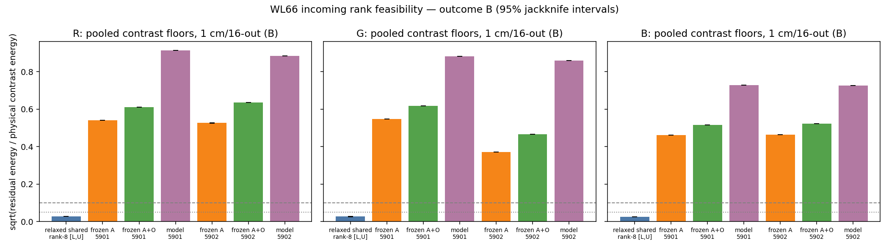

# Worklog66 — Incoming angular rank feasibility of the frozen WL59 P intrinsic K (2026-11-01)

## Authorisation and scope

The user's brief of 2026-11-01 authorised one bounded architectural feasibility experiment. It asks whether the frozen WL59 P model's shared 16-incoming-bin → 8-mixture angular compression has a physically significant information bottleneck under qualified collided first-exit references. The probes are spatially localized directional incidences.

It was motivated by three earlier results:

- WL63: the qualified Pair7 failure is dominated by learned collided transport.
- WL64: a fixed directional-contrast supervision intervention was rejected.
- WL65: a qualified partial clean-label A/B gave no meaningful held-out benefit.
- WL60 had bounded only the outgoing span, not the incoming compression under independent localized angular excitation.

The batch runs on branch `Selective_Recompute` from start `2731a93`. There is no new branch or worktree.

Allowed work:

- isolated probe generation;
- representation-space analysis;
- precision accounting;
- tests and reports.

Prohibited:

- any change to network, checkpoint, rank or mixture count, loss or thresholds;
- retraining;
- clean-label interventions;
- K/C ownership or F/S changes;
- coupled GI;
- any successor.

WL59–65 and every historical protocol and checkpoint are preserved unchanged.

Read before design:

- the current contracts in the `AGENTS.md` summary;
- the WL59 runtime and model algebra (`r57_model.Transport`, `fnto_persist59/runtime.py`, `train.py`, `evaluate.py`);
- WL60's frozen bounds and replay;
- WL63's tagging (`tag_reference.py`) and its result;
- WL64/65 results;
- the r57/p53 first-exit oracle and its `cell_source` semantics.

## Prospective design (committed before any evidence)

[Design](../plans/INCOMING_RANK_FEASIBILITY66_V1.md) and [protocol](../../experiments/fnto_rank66/protocol/rank66_v1.json) were written against the **implemented** algebra.

**Incoming factorisation.** For a fixed geometry, port and channel, the scattered response to unit flux in bin a is row a of `D_i Aᵀ G_i`. A is one global column-stochastic 8×16 softmax per channel. In budget-normalised coordinates `Z = D⁻¹R`, the model is exactly `AᵀG`.

**Consequence of column-stochastic A.** Because `Aᵀ1 = 1` for every parameter value, every member of the architecture represents the bin-independent component exactly. Its contrast space `H·range(Aᵀ)` is at most 7-dimensional and is shared by all ports and geometries.

**Valid bounds that follow.** These relaxed lower bounds hold for any parameters and any training:

- the per-port relaxed bound;
- the pooled shared relaxed bound;
- the frozen-A bound;
- the frozen-A+O bound (free signed spatial coefficients);
- outgoing controls.

**Estimators.** Replica cross-products are U-statistics. The relaxed floor is bracketed: a low-biased estimator from cross-Gram tail concavity, and a high-biased one from held-out split subspaces. Fixed-projector floors and model errors are unbiased. Uncertainty is a delete-one-replica jackknife.

**Verdict.** The verdict is fixed on the primary 1 cm/16-out contrast metric, with thresholds 0.10 / 0.05 / 25% and A > B > C > D precedence. The rationale is recorded in the protocol before evidence: the absolute metric's denominator is dominated by a component that the architecture cannot lose.

Port selection is geometry-only and deterministic: 2085 (top dent centre), 2441 (top dent flank), 1123 (top far control), 2069 (bottom below dent). It was computed before any reference. `1−β ≥ 0.9899` at both geometries.

**Budget rule.** K=8 replicas of 32M per probe if predicted walk time ≤4 h. The resource preflight fixes the numeric budget, which is committed before generation.

**Checkpoints.**

- Primary: WL59 P_5901 / P_5902.
- Secondary, descriptive: WL64-B and WL65-B.

### Non-evidence smoke run and one pre-commit correction (disclosed)

Before the protocol commit, the whole pipeline ran in a scratch root (`~/rank66_smoke`) with 2M-photon packets and K=4 replicas. That is 1/16 of the evidence budget per packet, and half the replicas.

- **Seeds.** The smoke used the evidence seed formula, so its photon streams are not independent of the later evidence packets. The smoke is never pooled with evidence or used in the verdict.
- **Gates.** All 512 smoke packets passed the physical and tag gates. Replay reproduced WL59 at 8.0e-8 / 7.5e-8. Factorisation and model-span residuals were ≤6.4e-8. Packet-moment noise matched the across-replica scatter (median ratio 1.013).
- **Outcome seen.** The smoke analysis printed per-channel categories (B in every channel at smoke precision) before the protocol commit. **No decision rule, threshold, metric, population, port, budget or seed was changed after that output.**

The smoke exposed one code-correctness defect, which was corrected before the commit:

- **Defect.** The frozen contrast basis `H·range(Aᵀ)` was built with a 1e-10 relative rank tolerance. That retained a float32-softmax noise direction (singular value ~4e-8), giving rank 8 instead of the architecture-exact ≤7. The extra direction enlarged the frozen-A projection space and biased F_A **low**.
- **Fix.** The basis now uses relative tolerance 1e-5 with an explicit cap of 7, as the protocol's algebra states.
- **Verification.** A new test confirms rank 7 and equality with the absolute `range(Aᵀ)` residual for random float32 column-stochastic A. Rerun on the smoke: rank 7 in all 18 checkpoint/channel cases, and F_A equals the absolute residual to ≤5e-7 relative.

One test tolerance was also changed. The check `1 ∈ range(Aᵀ)` used 1e-8, which is below float32 softmax rounding (observed 7.4e-8); it now uses 1e-6. This change was made before any smoke analysis.

The smoke outputs, including the defective first analysis, are preserved under `~/rank66_smoke/smoke_v1_bugged/` and `~/rank66_smoke/`.

## 사용자 별도 요청으로 인한 성능 개선안 (performance assessment requested separately by the user)

During evidence generation the user separately requested a resource-efficiency assessment: keep GPU load high and prevent CPU-side work from becoming the bottleneck. The assessment was **observation-only**. Nothing was benchmarked against the running chain and nothing in the running batch was changed. Every measurement and verdict above is unaffected.

**Passive measurements** (LabServer69 RTX 3090 / i7-6900K 8C16T; generation stage, about 300/1024 packets done):

- **GPU duty cycle.** `nvidia-smi dmon` over 40 s shows a regular ~3.3 s cycle. Each cycle has about 1 s at SM 90–100% and about 2 s at SM 5–20%. Mean SM utilisation is about 40%. No other GPU compute process was present: resource contention is not the cause.
- **CPU.** One process main thread runs at 100%, with every other thread idle. Whole-machine CPU is 6% and the load average is about 1.1.
- **Per-packet time.** Wall time per packet is 3.34 s: 3.18 s walk (`r['seconds']`) plus about 0.16 s (≈5%) for `torch.save` of 44 MB, SHA-256 and the receipt.
- **Memory.** Peak allocated GPU memory per packet is 9.4 GB of 24 GB.

**Cause.** `r57_fastwalk.walk` advances one Python loop iteration per scattering step. Each step forces host–device synchronisations (`nonzero`, `len`, `.any`) and launches many small kernels. With albedo 0.999, path lengths are long-tailed. In the late part of every 32M packet only a few photons survive, so each step is launch- and sync-latency bound on a single CPU thread while the GPU idles. This is structural to the frozen walker, not contention.

**Options assessed:**

1. **Concurrent packet workers (2 per GPU).** Two workers process disjoint packet lists. While one is in its tail, the other fills the GPU. The estimated throughput gain is about 1.6–1.9×; this is not measured, because measuring now would contend with evidence generation.
   - Memory: about 19 GB of 24 GB.
   - The estimator, seeds and the 32M chunk stay unchanged, so the result is the same estimator with statistically identical evidence. Bitwise identity is not guaranteed even serially, because of CUDA atomics.
   - It is an execution-policy change, so it would need a commit and a worklog record.
   - It is applicable without touching the reference source.
2. **Asynchronous save/hash in a background thread.** About 5%; low risk.
3. **Parallel packet loading in the analysis stage** (thread pool). The ≈4 min load would drop to an estimated 1–2 min; low risk.
4. **Walker-level changes.** CUDA Graphs, wavefront regeneration of terminated photons, removal of per-step host syncs. This is the largest potential gain (several-fold). However, it changes the hash-frozen reference estimator, so it would require a separately authorised execution-equivalence validation (as for WL57's fastwalk). It is **not admissible inside this batch**.
5. **≥3 concurrent workers.** These would need a chunk below 32M, which departs from the established execution policy. Not recommended.

**Status.** The user did not ask to change the running batch. WL66 generation continues unchanged and serial. Options 1–3 remain unapplied and unmeasured. A short non-contending throughput measurement of option 1 is possible only after this batch's chain has completed, and only if the user requests it.

## Execution

The protocol, estimators and tests were committed as **a3ba1ae** before any evidence. The first deploy used `git archive` with `core.autocrlf=false` only and produced CRLF sources: `.gitattributes` has `* text=auto`. The hash check caught it before any execution. The source was redeployed with `core.eol=lf`, and all 12 deployed files equal the committed blobs.

Pre-phase on LabServer69:

- ports: 2 s;
- 11/11 tests: 9 s;
- resource preflight: 28 s. The two 32M smoke packets took 3.19 / 2.12 s of walk time.

The preflight rule gave **K = 8** replicas × 32M per probe: 1024 packets, **32.768B photons**, 0.76 h predicted walk time. This numeric budget was committed as **12732d7** before generation.

Main chain:

- generation: 3,159 s, all 1024 packets passing physical, one-hot, unit-flux and 1e-12 tag gates; peak GPU 11.2 GB allocated;
- frozen-model stage: 42 s;
- analysis: 267 s; peak GPU 6.0 GB, RSS 9.9 GB;
- export: 1 s.

Every stage boundary recorded **no other GPU compute process**. There were no failed packets, quarantines, amendments or budget changes. The chain reached `done outcome B` at 02:29 server time.

## Final report

### Implementation Fact

- **Probes.** 128 independent localized one-hot probes: 2 geometries × 4 geometry-selected ports × 16 incoming bins. Each probe has 8 independent 32M replicas of the unchanged first-exit estimator with observational zero-collision/collided tags.
- **Model outputs.** The frozen-model stage read no physical data. It applied 6 unchanged checkpoints: WL59 P_5901/5902 primary; WL64-B and WL65-B secondary.
- **Analysis.** Physical and model data meet only in the analysis stage. All floors are computed in the model's own β-normalised incoming coordinates, which is the implemented algebra.
- **Nothing changed.** No model, checkpoint, rank, loss, threshold, K/C, F/S or coupled-GI change. Nothing trained.

### Measurement — identities and precision

| Check | Result |
|---|---|
| Frozen replay vs immutable WL59 pt0 actions | 7.87e-8 / 7.86e-8 (gate 2e-5) |
| Apply output vs direct `D Aᵀ G` factorisation (all ckpt × geometry × port) | ≤ 5.7e-8 |
| Model Z prediction inside range(Aᵀ) and inside the frozen A+O block span | ≤ 6.2e-8 |
| Frozen contrast basis rank, all 18 ckpt/channel | 7 (architecture-exact) |
| Packet tag closure / physical gates | 1024 / 1024 pass |
| Packet-moment noise ÷ across-replica scatter (72 matrices) | median 0.997, range 0.942–1.048 |
| Precision: per-matrix S_C / SE (coarse) | min **1794** (gate ≥ 10) |
| Precision: pooled SE / S_C (coarse) R / G / B | 7.8e-5 / 8.3e-5 / 1.1e-4 (gate ≤ 0.05) |
| Physical zero-collision fraction vs model β, summed over 16 bins | rest 1.1e-4 / 1.1e-4; pt0 s0 0.0544 / 0.0554; s1 0.0026 / 0.0025; s3 0.0450 / 0.0452 |
| Mean total exit energy per unit probe R / G / B | rest 0.981 / 0.852 / 0.481 |

Physical symmetry and locality invariants hold:

- At rest, the top and bottom dent-centre probes and the two top interior probes give identical statistics.
- The far control port is identical at rest and pt0.

**The precision gate passed with a wide margin. The verdict therefore rests on the bounds, not on noise.**

### Measurement — primary contrast floors

These are pooled over the 8 (geometry, port) matrices, 1 cm / 16-out. Each value is ρ = √(residual energy / physical contrast energy). Jackknife 95% intervals are narrower than ±0.001 everywhere.

| Channel | Relaxed shared rank-8 [L_lo, U_hi] | Frozen A 5901 / 5902 | Frozen A+O 5901 / 5902 | Frozen model 5901 / 5902 | Category |
|---|---|---|---|---|---|
| R | [0.0265, 0.0268] | **0.540 / 0.526** | 0.611 / 0.635 | 0.914 / 0.885 | **B** |
| G | [0.0263, 0.0266] | **0.548 / 0.370** | 0.617 / 0.466 | 0.881 / 0.859 | **B** |
| B | [0.0250, 0.0252] | **0.460 / 0.463** | 0.515 / 0.522 | 0.729 / 0.725 | **B** |

Nesting holds everywhere: relaxed ≤ frozen A ≤ frozen A+O ≤ model, and frozen O ≤ frozen A+O.

Energy shares of the model's contrast error:

| Floor | Share of model contrast-error energy |
|---|---|
| Frozen A | 0.35 / 0.35 (R), 0.39 / 0.19 (G), 0.40 / 0.41 (B) |
| Frozen A+O | 0.45 / 0.52, 0.49 / 0.29, 0.50 / 0.52 |

Other output spaces (primary seeds, all channels):

| Space | Relaxed | Frozen A | Frozen A+O | Model |
|---|---|---|---|---|
| fine16 | 0.051–0.055 | 0.42–0.62 | 0.65–0.75 | 0.95–1.00 |
| native | 0.059–0.064 | 0.42–0.61 | 0.67–0.77 | 0.95–1.00 |

The coarse relaxed floor is above the pure per-port sum because of sharing: pooled/per-port tail ratio 1.71–1.91. At fine16/native the sharing cost is only 1.005–1.017.

**Secondary checkpoints, descriptive.** Same pattern; neither intervention removed the frozen-A floor.

| Checkpoint | Coarse frozen A | Coarse model |
|---|---|---|
| WL64-B (contrast objective) | 0.55–0.65 | 0.90–1.11 |
| WL65-B (partial clean labels) | 0.35–0.63 | 0.73–0.90 |

### Measurement — absolute metric, outgoing side, ballistic (reported, not adjudicated)

- **Contrast share of the signal.** The contrast energy is only **0.7–1.0%** of the β-normalised probe response energy at 1 cm, and 3.8–4.0% at fine16/native. The bin-independent component dominates, and the architecture always represents it exactly.
- **Coarse absolute Z-metric.**

  | Floor | ρ |
  |---|---|
  | Relaxed | 0.0023–0.0025 |
  | Frozen A | 0.031–0.047 |
  | Frozen A+O | 0.083–0.087 |
  | Model | 0.099–0.105 |

  Raw collided error equals the Z values to 3 digits (min d = 0.9899).
- **Outgoing side.** The relaxed outgoing rank-8 contrast floor is 0.014 (coarse) and 0.054–0.058 (native). The frozen O floor is 0.05–0.11 (coarse) but 0.28–0.36 (native).
- **Ballistic.** Model B versus tagged physical zero-collision: relative error 0.075 (coarse), 0.161 (fine16), 0.258 (native). Zero-collision energy is ≤ 5.5% of probe flux at these ports.

### Observation

- **Physical contrast spectrum.** The pooled 1 cm contrast spectrum is concentrated in three directions: 43 / 32 / 22% (R), 43 / 31 / 25% (G), 54 / 25 / 19% (B). The next two directions are 0.5–0.9% each, and the rest are ≤ 0.06%. 14–15 of 16 eigenvalues are resolved at > 3 SE, so the small ones are real but tiny, not noise.
- **Frozen A misaligned with physics.** Principal-angle cosines between the frozen 7-dim contrast basis and the physical top-7 subspace are 0.85–0.999 for the first three angles, then fall to 0.43–0.89 and 0.02–0.57. Frozen `H Aᵀ` singular values span 0.22 → 0.015. A is close to uniform mixing, but its span is what matters for the floor.
- **Port and geometry dependence.**
  - Probes at interior positions of a 1 cm cell have contrast fractions of 0.23–0.56%. The far control port, which sits at a coarse-cell corner, has 2.9–3.1%, and its errors are the largest (model 0.91–0.99, frozen A 0.40–0.61).
  - The dent increases the contrast fraction at the dent-centre ports (0.23% → 0.35–0.38% R). The pooled-by-geometry floors differ by ≤ 0.03 between rest and pt0.
  - Blue has the lowest absolute errors at interior ports (model 0.35–0.46).
- **Historically inspected bin pair (8, 13), Pair7's bins.**
  - Pooled coarse frozen-A error on that contrast: 0.73–0.75 (R), 0.42–0.50 (G), 0.80–0.91 (B). Model: 0.91–1.13.
  - Across all 120 bin pairs, the median frozen-A error is 0.36–0.50 and the median model error is 0.85–0.92.

### Interpretation

- **The interface itself is not a material floor here.** On the tested localized-probe population, the shared rank-8 incoming interface imposes no material physical floor. Any parameter value of the architecture could represent the directional collided contrast to ρ ≤ 0.027 at 1 cm, and ≤ 0.064 even at the native 2.5 mm / 64-bin resolution. The physical angular response needs only about 3–5 contrast directions, well within 7.
- **The learned incoming basis is a large floor.** The *learned* A of both WL59 seeds discards ρ 0.37–0.55 (14–30% of contrast energy). That is materially more than the relaxed bound in every channel and both seeds: **Outcome B**.
- **But the learned basis is not most of the error.**
  - The frozen A floor accounts for only 19–41% of the frozen model's probe contrast error energy.
  - Allowing the frozen A and O bases with free signed spatial coefficients accounts for 29–52%.
  - The remaining roughly half of the error lies beyond the frozen angular bases. That part is attributable to spatial coefficients, geometry conditioning, positivity/passivity structure and fitting, which this batch does not separate.
- **Not attributable to one intervention.** WL64-B and WL65-B show the same floor structure, so it is not specific to one objective or label set.
- **Relation to Pair7.** These are localized probes, not the broad WL59 fields. The (8, 13) contrast is poorly represented by the frozen A, but this does not establish the cause of the original Pair7 error.

### Unresolved Question

- **Why the learned A diverges from the physical span.** It is unknown why training places the learned shared A away from the physically dominant 3-dim contrast subspace. Candidates are the training field population, the joint positivity/stochasticity of A, coupling with spatial coefficients, and optimisation.
- **Attainability by the constrained family.** It is unknown whether a better-aligned A would actually be attainable by the constrained positive, passive learned family.
- **The rest of the model error.** The roughly half of model contrast error outside the frozen A+O bases is unattributed.
- **The outgoing side at native resolution.** The native frozen-O floor (0.28–0.36) points to an outgoing-side learned-basis loss at 64 bins. It is outside the primary verdict and was not further examined.

### Architecture Verdict

| Claim | Verdict |
|---|---|
| Rank-8 shared incoming interface imposes a physically significant floor on these probes | **NOT SUPPORTED** (relaxed ρ ≤ 0.027 at 1 cm) |
| Current learned incoming basis loses materially more physical information than the relaxed bound | **SUPPORTED — Outcome B** (all channels, both seeds) |
| Learned incoming basis is the dominant cause of probe model error | **NOT SUPPORTED** (19–41% of error energy) |
| Original Pair7 error caused by the incoming basis | **NOT ESTABLISHED** (different population) |
| Whole-architecture viability / falsification | **Not assessed** outside the tested population |

No rank change, retraining, basis replacement, K/C or F/S change, coupled GI or successor is adopted or started. Living documents are unchanged: this is a bounded measurement, not a research-direction decision.

### Reproducibility

- **Commits.** Protocol, code and tests: `a3ba1ae`. Numeric budget: `12732d7`. Results and this worklog: the commit that adds them.
- **Server root.** `~/rest_rank66` on LabServer69. It retains all 1024 raw packets (45 GB, each with a receipt: seed, SHA-256, gates, RNG-state hash) and the frozen-model outputs.
- **Evidence bundle.** `results/fnto_rank66/final/`: analysis, receipts, model/replay/factorisation records, ports, budget, preflight, stage markers, logs. Tar SHA-256 `7b3f7e57…f163`. Reviewer exports and provenance are in [results/evaluation/66](../../results/evaluation/66/).
- **Fixed parameters.**
  - Seeds: `680000000 + g·100000 + slot·10000 + bin·100 + replica`; smoke `689000000 + g`.
  - Ports: 2085 / 2441 / 1123 / 2069.
  - Geometry signatures, β rows and frames: `ports.json`.
- **Checkpoints.** SHA-256 values are in the protocol.
- **Environment.** Python 3.10, torch per `preflight.json`, fast walker, 32M action chunk, the WL59 `run.sh` exports, uncontended GPU.

**Completion answer.** On the tested localized collided probes, the shared rank-8 incoming interface **itself does not impose a demonstrable physical fidelity floor**: the relaxed bound is ρ ≤ 0.027 at 1 cm, because physics needs only about 3–5 contrast directions. The **learned** incoming basis does lose material information (ρ 0.37–0.55, Outcome B). However, it explains only 19–41% of the frozen model's probe contrast error energy, and the frozen A+O bases explain 29–52%. The major remaining error is still attributable to unisolated spatial-coefficient, geometry-conditioning, positivity/passivity or fitting constraints.
